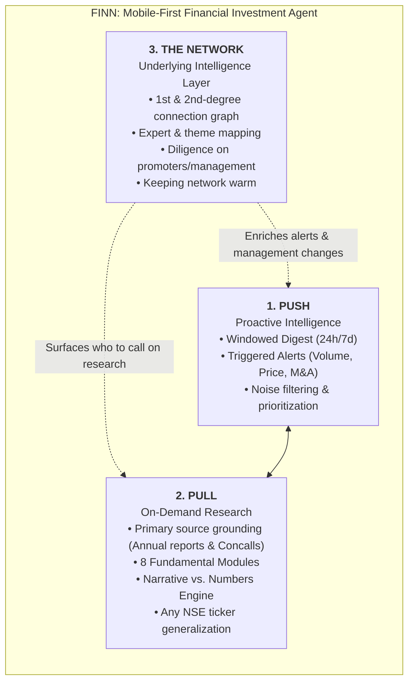
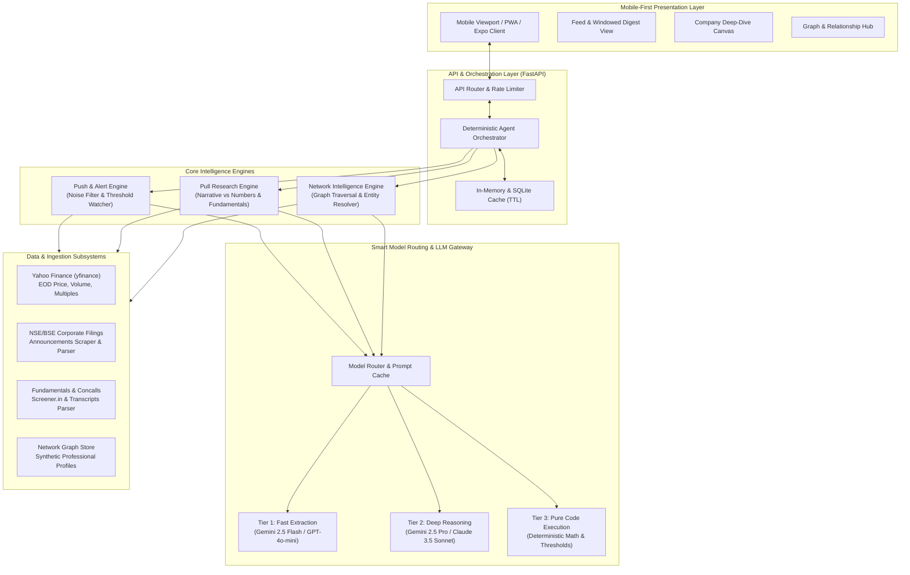
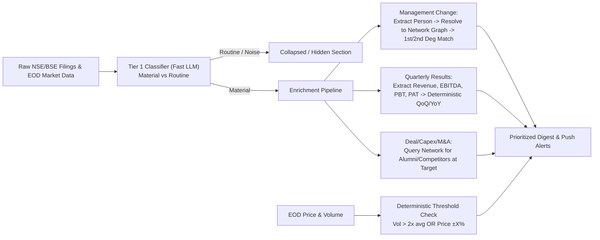
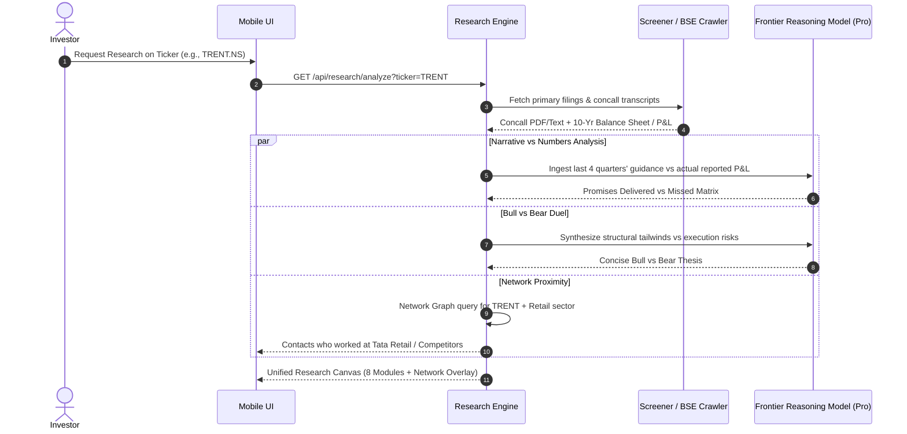
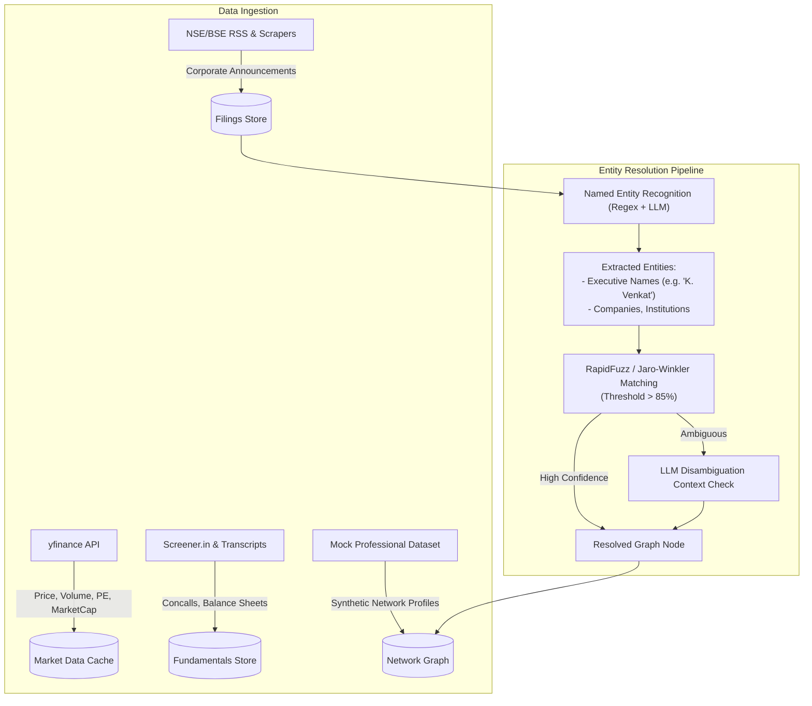
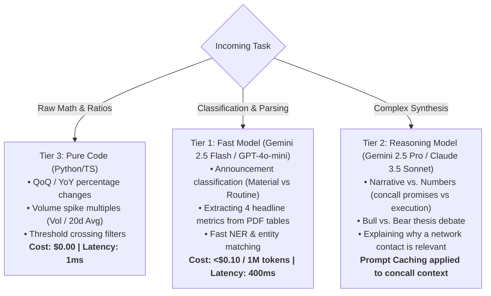
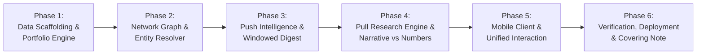

# High-Level Design (HLD): FINN — Financial Investment Agent

**Role:** Founding AI Engineer Challenge  
**Firm:** ENAM Holdings Pvt. Ltd.  
**Author:** AI System Architecture  
**Target:** Mobile-First Financial Investment Agent (Push • Pull • Network)  
**Date:** November 2026  

---

## 1. Executive Summary & Vision

Modern public-market investors face an asymmetric information problem:
1. **The Signal-to-Noise Trap**: Markets continuously produce noise (routine filings, price fluctuations, generic macro updates). Surfacing the 2% of material events while burying routine administrative filings is the core challenge.
2. **The Underutilized Network**: An investor's highest-alpha asset is their personal and professional network (former colleagues, founders, alumni, industry executives). Yet, this knowledge remains passive and fragmented across contact lists and memories.

**FINN** is an AI-powered, mobile-first intelligence platform designed to become an indispensable daily companion for high-conviction public market investors. It operates across three tightly integrated pillars:



---

## 2. System Architecture Overview

FINN utilizes a decoupled, modern architecture designed for real-time responsiveness, primary source grounding, and mobile-first ergonomics.



---

## 3. Subsystem Deep Dives

### 3.1 Push Subsystem: Proactive Intelligence

The Push layer delivers actionable intelligence without being queried.



#### Key Workflows:
1. **Windowed Digest (Configurable Timeframe: 24h, 7d, Custom)**:
   - Groups announcements across the user's 15–20 portfolio stocks.
   - Filters out routine administrative filings (e.g., loss of share certificates, secretarial compliance) into an expandable "routine filings" tray.
   - Puts high-conviction events at the top with single-line AI synthesis.
2. **Triggered Anomaly Alerts**:
   - Volume spikes exceeding $N \times$ 20-day moving average (e.g. $>2.0\times$).
   - Price movements exceeding $\pm X\%$ in a session.
   - Instant critical announcements (C-suite resignation, forensic audit, regulatory action).
3. **Automated Contextual Enrichment**:
   - *Management changes*: Automatically queries the incoming/outgoing executive's background, identifies their alma mater and past companies, and traverses the investor's network graph to detect 1st or 2nd-degree mutuals.
   - *Quarterly results*: Instantly extracts the primary tables and computes QoQ and YoY metrics deterministically.

---

### 3.2 Pull Subsystem: Grounded Primary Research

The Pull layer is an on-demand deep-dive engine. **Strict discipline: It relies exclusively on primary data (concall transcripts, annual reports, audited financial tables).** No third-party broker summaries or sensational financial news are used.



#### The 8 Research Modules:
| Module | Primary Source | Extraction & Logic |
| :--- | :--- | :--- |
| **1. Business Snapshot** | Annual Report / 10-K | Segment revenue mix, operating model, core value drivers. |
| **2. Financial Snapshot** | Screener Financial Statements | TTM Revenue, EBITDA margin, PAT, ROCE, P/E, EV/EBITDA. |
| **3. Trajectory** | 5-Year Financial Statements | Multi-year CAGR of top-line, margin expansion/compression trends. |
| **4. Balance Sheet** | Balance Sheet Filings | Gross vs Net Debt, D/E ratio, working capital cycle (days). |
| **5. Cash Quality** | Cash Flow Statement | CFO vs PAT conversion ratio ($CFO / EBITDA$), FCF yield. |
| **6. Narrative vs. Numbers** | Last 4 Qtr Concall Transcripts + Results | **Flagship Feature**: Compares CEO/CFO forward guidance against actual subsequent delivery. |
| **7. Guidance** | Latest Concall Transcript | Explicit capex targets, revenue growth guidance, margin targets. |
| **8. Bull vs. Bear** | Annual Report + Industry Primary Filings | High-density 3-point bull case vs 3-point structural risks. |

---

### 3.3 The Network Intelligence Subsystem

The Network transforms passive contacts into an active, contextual intelligence layer that is woven directly into Push and Pull.

```mermaid
graph TD
    INVESTOR(["Investor (Root)"])
    
    INVESTOR -->|1st Degree (Strong)| P1["Contact: Rajesh Sharma<br/>Ex-VP Supply Chain, Asian Paints<br/>IIM-A '14"]
    INVESTOR -->|1st Degree (Medium)| P2["Contact: Anita Desai<br/>Director of Finance, Info Edge<br/>Ex-McKinsey"]
    INVESTOR -->|1st Degree (Strong)| P3["Contact: Vikram Malhotra<br/>Partner, Peak Ventures<br/>IIT-D '15"]
    
    P1 -->|Worked At| COMP1["Asian Paints (Portfolio)"]
    P1 -->|Domain Expert| SECT1["Specialty Chemicals"]
    P2 -->|Colleague 2nd Degree| P4["Incoming CFO: Sameer Roy<br/>(Target Company)"]
    P3 -->|Co-investor / Board| COMP2["IndiGo / InterGlobe"]
    
    classDef highlight fill:#e1f5fe,stroke:#0288d1,stroke-width:2px;
    class P1,P2,P4 highlight;
```

#### Graph Schema Design:
- **Nodes**:
  - `Investor` (Self)
  - `Person` (Name, Current Role, Current Company, Past Roles, Education, Seniority, Closeness Score 1–5)
  - `Company` (Ticker, Name, Sector, Market Cap Category, Portfolio Status: True/False)
  - `Sector / Theme` (e.g. Specialty Chemicals, Rural Lending, EMS/Semiconductors)
  - `Institution / Alma Mater` (e.g. IIT Delhi, IIM Ahmedabad, McKinsey)
- **Edges**:
  - `KNOWS` (Investor $\to$ Person: closeness, last interaction date)
  - `WORKED_AT` (Person $\to$ Company: role, start year, end year, is_current)
  - `STUDIED_AT` (Person $\to$ Institution: degree, batch year)
  - `COMPETITOR_OF` (Company $\leftrightarrow$ Company)
  - `HAS_EXPERTISE` (Person $\to$ Sector)

#### The 5 Core Network Scenarios:
1. **Who Should I Call?**:
   - Query: *“I'm researching Tata Motors EV expansion.”*
   - Algorithm: Traverses graph for 1st-degree contacts at Tata Motors, Tata Power, or direct competitors (Mahindra EV, Ola Electric), ranked by role relevance (Supply Chain, Battery R&D) and relationship strength.
2. **Second-Degree Reach**:
   - Query: *“Who can introduce me to the new CFO of Dixon Technologies?”*
   - Algorithm: Executes shortest-path bidirectional BFS. Finds mutual connections (e.g., "Your former colleague Anita worked with him at Philips from 2018–2021").
3. **Diligence on People**:
   - Analyzes career trajectory, job-hopping frequency, alumni networks, and shared connections before meeting a promoter or executive.
4. **Expertise Map**:
   - Clustered thematic search across the investor's contact base for deep niche themes (e.g., contract manufacturing, agrochemicals).
5. **Keeping the Network Warm**:
   - Trigger-based proactive nudges: When a company in the portfolio announces stellar results, a major acquisition, or a leadership change, FINN notifies the investor: *"Anita worked at this firm for 5 years. Great natural touchpoint to reach out."*

---

## 4. Data Pipelines & Entity Resolution



---

## 5. AI Architecture, Model Routing & Cost Optimization

To eliminate "AI slop" and keep operations comfortably within free/low-cost tiers, FINN implements strict **three-tier model routing**:



### Cost & Efficiency Optimization Pillars:
1. **Zero-Arithmetic Policy for LLMs**: Financial ratios, percentage changes, and moving averages are strictly computed in Python code, avoiding hallucinated calculations.
2. **Context Window Prompt Caching**: Concall transcripts are cached at the provider level (Gemini / Anthropic prompt caching). Subsequent questions on the same transcript incur up to 90% lower latency and 75% lower cost.
3. **Structured Outputs**: All LLM calls enforce JSON Schema validation via Pydantic, ensuring fail-safe serialization into mobile UI components.

---

## 6. Data Security, Privacy & Compliance

Because FINN manages sensitive network data and investment portfolios, the architecture implements zero-trust principles:

1. **Strict Client Isolation**:
   - The investor's personal network graph is encrypted at rest using AES-256 and stored in an isolated tenant partition.
   - Network contacts are never indexed into public LLM training corpuses.
2. **PII Masking Gateway**:
   - Before any network prompt is sent to external cloud LLM APIs, personal contact details (phone numbers, email addresses, personal notes) are stripped or pseudonymized.
3. **Realistic Synthetic Demarcation**:
   - In accordance with challenge rules, the demo network is built using realistic synthetic profiles overlapping the portfolio companies, clearly flagged in the system metadata.

---

## 7. Architectural Decisions & Trade-off Analysis

### 7.2 Settled Architectural Decisions

| Decision Area | Selected Architecture | Alternative Considered | Rationale & Trade-off Resolution |
| :--- | :--- | :--- | :--- |
| **Mobile Client Architecture & Delivery** | **Next.js 14+ Mobile-First Responsive Web (PWA)** *(User Confirmed)* | React Native with Expo | **Zero Reviewer Friction**: Evaluators can open a live Vercel URL or scan a QR code on any iPhone/Android browser and immediately test the working app without needing to download Expo Go or configure matching SDK versions. A centered mobile viewport frame provides a mobile experience on desktop while rendering full-bleed on mobile devices. |
| **Graph Intelligence Engine** | **In-Memory NetworkX + SQLite adjacency** | Dedicated Neo4j / Memgraph cluster | An investor's personal network contains ~100–1,000 nodes and ~5,000 edges. Neo4j introduces JVM overhead, Docker management, network latency, and cloud costs. NetworkX executes BFS/shortest-path queries in microseconds in-memory with zero operational overhead. |
| **Financial Calculations** | **Deterministic Code (Pandas / TS math)** | LLM calculation | LLMs frequently hallucinate basic arithmetic in tables. Pure code guarantees 100% mathematical accuracy on QoQ/YoY margins and volume multiples. |
| **Agent Architecture** | **Direct Modular Pipeline with Pydantic** | Heavy Agent Frameworks (CrewAI / AutoGen) | Heavy multi-agent frameworks introduce unpredictable token loops, fragile tool-calling chains, and high latency. A structured pipeline is deterministic, ultra-fast, and reproducible. |
| **Demo Data Resilience** | **Pre-Seeded Hybrid Cache + Live Crawler** | Pure Live-Only Scraping | Scraping NSE/BSE during a live demo is vulnerable to IP bans, CAPTCHAs, or downtime. Pre-seeding the 15–20 portfolio stocks guarantees zero demo failure, while an on-demand live crawler proves generalization for any new ticker. |

---

## 8. Incremental Phase-Wise Implementation Plan

The implementation is structured into **6 strictly incremental phases**, where every phase delivers a working, verifiable layer before the next is built:



### Phase 1: Core Scaffolding & Portfolio Data Engine
- **Objective**: Establish the repository, backend service, and data layer for the 15–20 NSE portfolio companies and ad-hoc tickers.
- **Deliverables**:
  - Mock portfolio of 15–20 diverse NSE stocks (e.g. RELIANCE, TCS, HDFCBANK, TRENT, DIXON, DEEPAKNTR, TATAELXSI, KAYNES, PIDILITIND).
  - Data ingestion module for price, volume, and 20-day moving averages via `yfinance`.
  - Corporate announcements parser (simulated & live NSE feed).
  - Screener.in fundamentals extractor for balance sheets and P&L tables.
- **Verification**: CLI script verifying that market data and filings are fetched and cached for all 20 portfolio tickers.

### Phase 2: The Network Intelligence Engine & Entity Linker
- **Objective**: Build the investor's network graph and connection-resolution algorithms.
- **Deliverables**:
  - Graph representation using `NetworkX` with nodes (Person, Company, Sector, Alma Mater) and typed edges.
  - Mock network dataset of ~50 realistic industry executives, former colleagues, and classmates that overlap with the portfolio and research companies.
  - Algorithms for:
    - *Who Should I Call?* (Target, Competitor, Supplier matching).
    - *Second-Degree Reach* (Shortest path discovery).
    - *Expertise Mapping* (Thematic lookup).
  - Entity Resolution module: matches executive names from filings to graph nodes.
- **Verification**: Unit tests verifying shortest path between investor and executive, and keyword-to-expert mapping.

### Phase 3: Push Subsystem (Windowed Digest & Triggered Alerts)
- **Objective**: Build the proactive intelligence pipeline that filters noise and enriches high-signal events.
- **Deliverables**:
  - Windowed Digest aggregator (filtering announcements into Material vs Routine for 24h / 7d windows).
  - Anomaly trigger service: price move ($\pm X\%$) and volume spike ($>2\times$ 20d avg).
  - Management change enrichment pipeline (linking incoming executives to Network 1st/2nd degree contacts).
  - Quarterly results parser (calculating Revenue, EBITDA, PBT, PAT QoQ and YoY deterministically).
- **Verification**: Test script simulating incoming announcements and verifying that routine noise is collapsed, while material events receive network badges and calculated metrics.

### Phase 4: Pull Subsystem (Primary-Grounded Deep-Dive Research)
- **Objective**: Build the on-demand company analysis engine grounded in primary documents.
- **Deliverables**:
  - The 8 Research Modules (Business Snapshot, Financial Snapshot, Trajectory, Balance Sheet, Cash Quality, Narrative vs Numbers, Guidance, Bull vs Bear).
  - **Narrative vs. Numbers Engine**: Ingests concall transcripts and audits management promises against actual performance over the past 4 quarters.
  - Generalization layer: dynamic fetcher that runs the analysis on any arbitrary user-provided NSE ticker.
  - Network integration: dynamically surfaces who in the investor's network can be contacted for that specific company or sector.
- **Verification**: Generate research report on a demo portfolio stock and an ad-hoc ticker (verifying zero broker notes/news hallucination).

### Phase 5: Mobile-First Frontend & Unified Interaction Model
- **Objective**: Create the mobile interface delivering the Push, Pull, and Network experiences seamlessly.
- **Deliverables**:
  - Mobile-first responsive UI with bottom navigation:
    - **Tab 1: Push Feed**: Windowed digest, anomaly alerts, collapsible routine filings, network context chips.
    - **Tab 2: Pull Research**: Ticker search, 8 module cards, interactive Narrative vs Numbers comparison table, Bull/Bear duel.
    - **Tab 3: Network Explorer**: Interactive graph explorer, "Who Should I Call?" search bar, warm reconnect suggestions.
    - **Quick Action: Ask FINN Copilot**: Context-aware floating assistant to query the network or company data instantly.
- **Verification**: Tested on mobile viewport (iOS Safari and Android Chrome) with responsive touch controls.

### Phase 6: Deployment, Verification, AI History & Covering Note
- **Objective**: Deploy the live prototype and prepare submission deliverables.
- **Deliverables**:
  - Public GitHub repository with clean documentation and setup instructions.
  - Live deployed link (Vercel / cloud-hosted).
  - AI build log export detailing prompt strategies, course-corrections, and design tradeoffs.
  - Covering note writeup addressing data pipelines, security/privacy, LLM routing, and future roadmap.
- **Verification**: End-to-end user testing on a real mobile device via the live deployment URL.

---

## 9. Deliverables & Submission Checklist

- [x] Complete High-Level Design document (`FINN_HLD_ARCHITECTURE.md`)
- [ ] User alignment on open architectural decision (Next.js Mobile PWA vs Expo)
- [ ] Working mobile-first prototype deployed on public URL
- [ ] Public GitHub repository with clean modular codebase
- [ ] Documented AI build history
- [ ] Submission email covering note to `assessment@enam.com`
