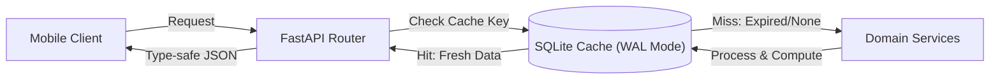
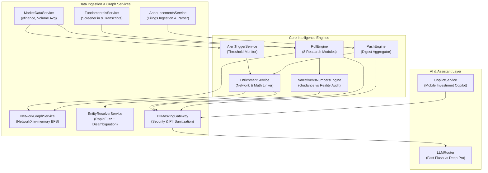
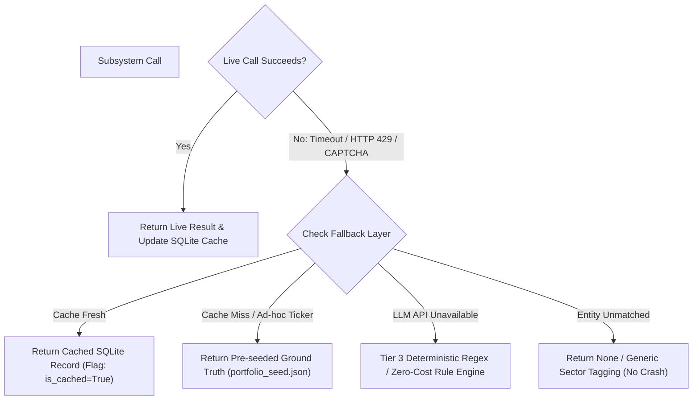
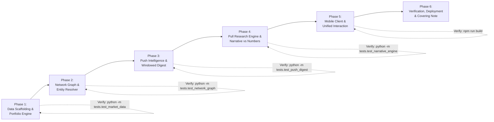

# Low-Level Design (LLD): FINN — Financial Investment Agent

**Role:** Founding AI Engineer Challenge  
**Firm:** ENAM Holdings Pvt. Ltd.  
**Author:** AI System Architecture & LLD Author  
**Target:** Mobile-First Financial Investment Agent (Push • Pull • Network)  
**Date:** November 2026  
**Status:** Approved for Implementation (All Adversarial Review Revisions Incorporated)  
**Companion Documents:** `FINN_HLD_ARCHITECTURE.md`, `ARCHITECTURE_DECISIONS.md`, `FINN_LLD_REVIEW.md`

---

## 1. Repository & Directory Structure

FINN is structured as a unified monorepo with clean separation between the Next.js 14+ mobile web presentation layer, the FastAPI orchestration backend, and the data/seeds directory.

```
/Users/harshallasod/Documents/ENAM/
├── ARCHITECTURE_DECISIONS.md          # Persistent Architectural Decision Records (ADRs)
├── FINN_HLD_ARCHITECTURE.md           # High-Level Architecture Design
├── FINN_LLD.md                        # This document (Exhaustive Low-Level Design)
├── FINN_LLD_REVIEW.md                 # Adversarial review findings and remediation audit
├── BUILD_LOG.md                       # AI build history, prompt strategy & course corrections
├── README.md                          # Quickstart, architecture overview, verification commands
│
├── backend/                           # FastAPI Python 3.11+ Orchestration Backend
│   ├── main.py                        # FastAPI application entrypoint, CORS, lifespan startup seed
│   ├── config.py                      # Pydantic BaseSettings: API keys, cache TTLs, DB path
│   ├── database.py                    # SQLite connection pool (WAL mode), session manager, DDL init
│   ├── requirements.txt               # Backend dependencies (fastapi, uvicorn, yfinance, networkx, etc.)
│   │
│   ├── api/                           # API Routes / Endpoints
│   │   ├── __init__.py
│   │   ├── deps.py                    # Dependency injection (DB session, Service singletons)
│   │   ├── routes_portfolio.py        # /api/portfolio (Ph 1), /api/portfolio/{ticker}/digest & /alerts (Ph 3)
│   │   ├── routes_research.py         # /api/research/{ticker}, /api/research/{ticker}/narrative
│   │   ├── routes_network.py          # /api/network/query, /api/network/graph, /diligence/{person_id}
│   │   └── routes_copilot.py          # /api/copilot/chat
│   │
│   ├── models/                        # Pydantic Data Models & Schemas (v2)
│   │   ├── __init__.py
│   │   ├── common.py                  # APIResponse wrapper, timestamps, error formats
│   │   ├── market.py                  # PortfolioStock, MarketData, MetricChange
│   │   ├── announcement.py            # Announcement, AnnouncementCategory, MaterialityScore
│   │   ├── research.py                # ResearchReport, FinancialSnapshot, Trajectory, BalanceSheet
│   │   ├── narrative.py               # NarrativeEntry, GuidanceAudit, BullBearThesis
│   │   ├── network.py                 # NetworkPerson, NetworkEdge, NetworkGraph, DiligenceResponse
│   │   ├── alert.py                   # Alert, AlertType, AnomalyTrigger, DigestWindow, DigestResponse
│   │   └── copilot.py                 # CopilotMessage, CopilotChatRequest, CopilotChatResponse
│   │
│   ├── services/                      # Business Logic & Intelligence Engines
│   │   ├── __init__.py
│   │   ├── market_data.py             # MarketDataService (yfinance fetcher, 20d MA, price thresholds)
│   │   ├── announcements.py           # AnnouncementsService (NSE/BSE filings & simulation feed)
│   │   ├── fundamentals.py            # FundamentalsService (Screener.in scraping & financials parser)
│   │   ├── network_graph.py           # NetworkGraphService (NetworkX graph, edge synthesis, BFS)
│   │   ├── entity_resolver.py         # EntityResolverService (RapidFuzz fuzzy matcher & disambiguation)
│   │   ├── push_engine.py             # PushEngine (Windowed digest aggregator & material filter)
│   │   ├── alert_trigger.py           # AlertTriggerService (Volume spike >2x, price shocks, resignations)
│   │   ├── enrichment.py              # EnrichmentService (Attaches network mutuals & QoQ math to events)
│   │   ├── pull_engine.py             # PullEngine (Orchestrates the 8 fundamental research modules)
│   │   ├── narrative_engine.py        # NarrativeVsNumbersEngine (Transcripts vs audited numbers audit)
│   │   ├── llm_router.py              # LLMRouter (Tier 1 Fast vs Tier 2 Reasoning vs Tier 3 Code)
│   │   ├── copilot_service.py         # CopilotService (Multi-turn contextual investment assistant)
│   │   └── pii_masker.py              # PIIMaskingGateway (Strips PII & anonymizes network data for LLMs)
│   │
│   ├── prompts/                       # LLM Prompt Templates
│   │   ├── __init__.py
│   │   ├── announcement_classifier.py # Material vs routine classification prompt
│   │   ├── narrative_audit.py         # Guidance extraction & delivery verification prompt
│   │   ├── bull_bear.py               # Structural thesis & antithesis prompt
│   │   ├── network_relevance.py       # Contextual reason to connect prompt
│   │   └── copilot_system.py          # Grounded financial copilot prompt
│   │
│   ├── storage/                       # Persistence & Seeds
│   │   ├── finn.db                    # SQLite file (auto-created on startup with WAL mode)
│   │   ├── portfolio_seed.json        # 20 NSE curated portfolio stocks with sectors & caps
│   │   └── network_seed.json          # 50 synthetic professional contacts overlapping portfolio
│   │
│   └── tests/                         # Backend Unit & Integration Tests
│       ├── test_market_data.py
│       ├── test_network_graph.py
│       ├── test_entity_resolver.py
│       ├── test_push_digest.py
│       ├── test_narrative_engine.py
│       └── test_api_endpoints.py
│
├── frontend/                          # Next.js 14+ Mobile-First Responsive PWA
│   ├── package.json                   # Dependencies (Next 14, React 18, Tailwind, Framer Motion, Lucide)
│   ├── tsconfig.json                  # TypeScript strict configuration
│   ├── tailwind.config.js             # Mobile-optimized tokens, colors, safe-area utilities
│   ├── next.config.js                 # PWA headers, API rewrites to FastAPI backend
│   │
│   ├── app/                           # Next.js App Router
│   │   ├── layout.tsx                 # Root layout with viewport metadata & font loading
│   │   ├── page.tsx                   # Redirects / to /push
│   │   ├── push/                      # Tab 1: Proactive Feed & Windowed Digest
│   │   │   └── page.tsx
│   │   ├── research/                  # Tab 2: Primary-Grounded Research Hub
│   │   │   ├── page.tsx               # Ticker search & portfolio selector
│   │   │   └── [ticker]/              # Deep-dive canvas for specific ticker (e.g. /research/TRENT)
│   │   │       └── page.tsx
│   │   └── network/                   # Tab 3: Relationship & Expertise Explorer
│   │       ├── page.tsx               # Graph visualization, search & warm reconnects
│   │       └── diligence/[personId]/  # Deep executive diligence dossier view
│   │           └── page.tsx
│   │
│   ├── components/                    # Reusable Mobile UI Components
│   │   ├── layout/
│   │   │   ├── MobileFrame.tsx        # Centered iPhone 15 Pro frame for desktop + full-bleed on mobile
│   │   │   ├── HeaderBar.tsx          # Top app bar with ticker search, time window pills
│   │   │   └── BottomNav.tsx          # Fixed bottom navigation bar (Push, Research, Network, Ask)
│   │   ├── push/
│   │   │   ├── DigestCard.tsx         # Prioritized announcement card with AI one-line synthesis
│   │   │   ├── AlertChip.tsx          # Anomaly trigger badge (Volume spike, Price movement)
│   │   │   ├── RoutineFilingsTray.tsx # Collapsible drawer for routine administrative noise
│   │   │   └── NetworkContextBadge.tsx# 1st/2nd degree mutual indicator embedded on announcements
│   │   ├── research/
│   │   │   ├── ResearchModuleCard.tsx # Base container for the 8 research modules
│   │   │   ├── BusinessSnapshot.tsx   # Module 1: Revenue mix, core operating model
│   │   │   ├── FinancialSnapshot.tsx  # Module 2: TTM revenue, margins, valuation multiples
│   │   │   ├── TrajectoryChart.tsx    # Module 3: 5-year CAGR, margin expansion visual
│   │   │   ├── BalanceSheetCard.tsx   # Module 4: Gross vs Net Debt, D/E ratio, working capital days
│   │   │   ├── CashQualityCard.tsx    # Module 5: CFO/PAT conversion, Free Cash Flow yield
│   │   │   ├── NarrativeTable.tsx     # Module 6: Flagship Promised Guidance vs Actual Reported table
│   │   │   ├── GuidanceSummary.tsx    # Module 7: Forward management targets & capex plans
│   │   │   ├── BullBearDuel.tsx       # Module 8: 3-point bull case vs 3-point structural risks
│   │   │   └── NetworkOverlay.tsx     # "Who to Call" strip for current company/sector
│   │   ├── network/
│   │   │   ├── NetworkGraphView.tsx   # Interactive canvas/SVG force graph rendering
│   │   │   ├── ContactCard.tsx        # Executive profile card with closeness meter & mutuals
│   │   │   ├── WarmNudgeCard.tsx      # Proactive "Reach out to Anita" context card
│   │   │   └── PathBreadcrumb.tsx     # 2nd-degree path visualization (You -> Anita -> Sameer)
│   │   └── copilot/
│   │       ├── CopilotDrawer.tsx      # Framer-motion slide-over drawer for interactive Q&A
│   │       └── ChatBubble.tsx         # Grounded message bubble with primary citations
│   │
│   ├── lib/                           # Client Utilities & API Client
│   │   ├── api.ts                     # Type-safe Fetch wrapper for backend endpoints
│   │   ├── types.ts                   # TypeScript interfaces matching backend Pydantic models
│   │   └── formatters.ts              # Financial number formatters (₹ Cr, percentages, multiples)
│   │
│   └── public/                        # Static Assets
│       ├── manifest.json              # PWA manifest
│       └── icons/                     # Mobile app icons
```

---

## 2. Backend — All API Endpoints (FastAPI)

All endpoints conform to standard REST conventions, enforce request validation, return structured JSON adhering to Pydantic response models, and implement caching.



### 2.1 GET `/api/portfolio`
- **Purpose**: Returns the list of tracked portfolio companies (15–20 stocks) enriched with real-time price, daily change, volume multiples, and active alert counters.
- **HTTP Method**: `GET`
- **Request Parameters**: None.
- **Response Schema**: `PortfolioListResponse`
  ```python
  class PortfolioListResponse(BaseModel):
      total_count: int
      last_updated: datetime
      stocks: list[PortfolioStock]
  ```
- **Service Called**: `MarketDataService.get_portfolio_summary()`, `AlertTriggerService.get_active_alert_counts()`
- **Caching Strategy**:
  - Cache Key: `portfolio:summary`
  - Storage: SQLite table `market_data_cache`
  - TTL: 300 seconds (5 minutes during market hours; 24 hours off-market)
- **Error Handling**: If `yfinance` times out or fails, returns pre-cached seed data from `portfolio_seed.json` with `is_stale: true` flag. Never returns HTTP 500.

---

### 2.2 GET `/api/portfolio/{ticker}/digest`
- **Purpose**: Returns the filtered and synthesized corporate announcements for a portfolio stock (or all stocks if `ticker=ALL`) within a time window (24h or 7d).
- **HTTP Method**: `GET`
- **Request Parameters**:
  - Path: `ticker` (string, e.g. `TRENT`, `RELIANCE`, or `ALL`)
  - Query: `window` (`DigestWindow` enum: `24h` or `7d`, default `24h`)
- **Response Schema**: `DigestResponse`
  ```python
  class DigestResponse(BaseModel):
      ticker: str
      window: DigestWindow
      generated_at: datetime
      total_announcements: int
      material_count: int
      routine_count: int
      material_announcements: list[Announcement]
      routine_announcements: list[Announcement]
  ```
- **Service Called**: `PushEngine.generate_digest(ticker, window)` which orchestrates `AnnouncementsService`, `LLMRouter` (Tier 1 classification), and `EnrichmentService`.
- **Caching Strategy**:
  - Cache Key: `digest:{ticker}:{window}`
  - Storage: Dedicated SQLite table `digest_cache`
  - TTL: 600 seconds (10 minutes)
- **Error Handling**: If LLM classification fails, falls back to deterministic keyword regex rules (e.g. "financial results", "resignation", "acquisition" marked material; "loss of share certificate" marked routine).

---

### 2.3 GET `/api/portfolio/alerts`
- **Purpose**: Retrieves all active proactive anomaly alerts (volume spikes $>2\times$, price shocks $>\pm 4\%$, high-impact C-suite resignations) across the portfolio.
- **HTTP Method**: `GET`
- **Request Parameters**: None.
- **Response Schema**: `AlertListResponse`
  ```python
  class AlertListResponse(BaseModel):
      count: int
      generated_at: datetime
      alerts: list[Alert]
  ```
- **Service Called**: `AlertTriggerService.check_all_triggers()`
- **Caching Strategy**:
  - Cache Key: `portfolio:active_alerts`
  - Storage: In-memory with SQLite write-through (`alerts` table)
  - TTL: 120 seconds (2 minutes)
- **Error Handling**: Returns empty list with `status: "operational"` if threshold calculations encounter missing volume series.

---

### 2.4 GET `/api/research/{ticker}`
- **Purpose**: Generates or retrieves the complete 8-module primary-grounded research report for any given NSE ticker (both portfolio stocks and ad-hoc tickers).
- **HTTP Method**: `GET`
- **Request Parameters**:
  - Path: `ticker` (string, e.g. `DIXON`, `KAYNES`, `PIDILITIND`, `ZOMATO`)
- **Response Schema**: `ResearchReportResponse`
  ```python
  class ResearchReportResponse(BaseModel):
      ticker: str
      company_name: str
      sector: str
      report: ResearchReport
      network_overlay: list[NetworkPerson]
      cached: bool
      generated_at: datetime
  ```
- **Service Called**: `PullEngine.get_full_report(ticker)` calling `FundamentalsService`, `MarketDataService`, `NetworkGraphService`, and `LLMRouter`.
- **Caching Strategy**:
  - Cache Key: `research:{ticker}:v1`
  - Storage: SQLite table `research_cache`
  - TTL: 86400 seconds (24 hours; fundamentals change quarterly)
- **Error Handling**: If Screener.in scraper fails for an ad-hoc ticker, returns a structured fallback payload indicating module status with partial rendering. Automatically registers ticker into `companies` table with `is_portfolio_holding = 0`.

---

### 2.5 GET `/api/research/{ticker}/narrative`
- **Purpose**: Retrieves the flagship **Narrative vs. Numbers** audit comparing management forward guidance from concalls against audited subsequent results.
- **HTTP Method**: `GET`
- **Request Parameters**:
  - Path: `ticker` (string)
- **Response Schema**: `NarrativeReportResponse`
  ```python
  class NarrativeReportResponse(BaseModel):
      ticker: str
      management_credibility_score: float  # 0.0 to 10.0 scale
      credibility_summary: str
      quarters_audited: int
      entries: list[NarrativeEntry]
      forward_guidance_commitments: list[str]
  ```
- **Service Called**: `NarrativeVsNumbersEngine.audit_ticker(ticker)`
- **Caching Strategy**:
  - Cache Key: `narrative:{ticker}:v1`
  - Storage: SQLite table `narrative_cache`
  - TTL: 604800 seconds (7 days)
- **Error Handling**: Pre-computed results for the 20 portfolio stocks are pre-seeded in SQLite. For ad-hoc tickers without available transcripts, returns status `no_transcripts_found` with guidance on primary filing availability.

---

### 2.6 POST `/api/network/query`
- **Purpose**: Executes natural-language and structured thematic queries across the investor's connection graph (e.g., "Who should I call for Tata Motors EV expansion?").
- **HTTP Method**: `POST`
- **Request Schema**: `NetworkQueryRequest`
  ```python
  class NetworkQueryRequest(BaseModel):
      query: str
      company_focus: Optional[str] = None
      sector_focus: Optional[str] = None
      max_results: int = Field(default=5, ge=1, le=20)
  ```
- **Response Schema**: `NetworkQueryResponse`
  ```python
  class NetworkQueryResponse(BaseModel):
      query: str
      resolved_focus: dict[str, Any]
      results: list[NetworkQueryResult]
  ```
- **Service Called**: `NetworkGraphService.query_network(query, company_focus, sector_focus, max_results)`
- **Caching Strategy**:
  - Cache Key: `netquery:{hash(query)}`
  - Storage: Dedicated SQLite table `network_cache`
  - TTL: 3600 seconds (1 hour)
- **Error Handling**: Falls back to direct company and sector node lookup if LLM intent parser fails.

---

### 2.7 GET `/api/network/graph`
- **Purpose**: Returns the full node-link graph data formatted for visualization in the mobile SVG/Canvas explorer.
- **HTTP Method**: `GET`
- **Request Parameters**:
  - Query: `center_node` (optional string, defaults to `INVESTOR_ROOT`)
  - Query: `depth` (integer, default `2`, max `3`)
- **Response Schema**: `NetworkGraphResponse`
  ```python
  class NetworkGraphResponse(BaseModel):
      nodes: list[NetworkPerson]
      edges: list[NetworkEdge]
      total_nodes: int
      total_edges: int
  ```
- **Service Called**: `NetworkGraphService.get_graph_snapshot(center_node, depth)`
- **Caching Strategy**:
  - Cache Key: `graph:snapshot:{center_node}:{depth}`
  - Storage: In-memory
  - TTL: Indefinite (invalidated on network mutations)
- **Error Handling**: Always returns pre-seeded 50-node graph from `network_seed.json`.

---

### 2.8 GET `/api/network/diligence/{person_id}`
- **Purpose**: Returns an executive diligence dossier for a specific person in the network or management filing.
- **HTTP Method**: `GET`
- **Request Parameters**:
  - Path: `person_id` (string, e.g. `p_014`)
- **Response Schema**: `DiligenceResponse`
  ```python
  class DiligenceResponse(BaseModel):
      person: NetworkPerson
      shortest_path_from_investor: list[str]  # e.g. ["You", "Anita Desai", "Sameer Roy"]
      degrees_of_separation: int
      common_alumni: list[str]
      common_past_employers: list[str]
      talking_points: list[str]
  ```
- **Service Called**: `NetworkGraphService.get_diligence_dossier(person_id)`
- **Caching Strategy**:
  - Cache Key: `diligence:{person_id}`
  - TTL: 86400 seconds (24 hours)
- **Error Handling**: Returns HTTP 404 with message `Person not found in network graph` if ID does not exist.

---

### 2.9 POST `/api/copilot/chat`
- **Purpose**: Mobile floating Copilot assistant for conversational financial inquiry, network interrogation, and narrative cross-examination with citations.
- **HTTP Method**: `POST`
- **Request Schema**: `CopilotChatRequest`
  ```python
  class CopilotChatRequest(BaseModel):
      messages: list[CopilotMessage]
      active_ticker: Optional[str] = None
      active_tab: Optional[str] = None  # "push" | "research" | "network"
  ```
- **Response Schema**: `CopilotChatResponse`
  ```python
  class CopilotChatResponse(BaseModel):
      response: CopilotMessage
      referenced_sources: list[str] = Field(default_factory=list)
      suggested_followups: list[str] = Field(default_factory=list)
      network_leads: list[NetworkPerson] = Field(default_factory=list)
      action_links: list[dict[str, str]] = Field(default_factory=list)
  ```
- **Service Called**: `CopilotService.handle_message(request)`
- **Caching Strategy**: Dynamic prompt caching at Gemini API tier; no server HTTP caching due to conversational state.
- **Error Handling**: If reasoning model fails, falls back to Tier 1 fast model with prompt `Summarize verified financial facts for {ticker}`.

---

## 3. Backend — All Data Models (Pydantic v2)

The following is the complete, actual Python code for all data models. All datetime defaults use modern timezone-aware UTC instantiations (`datetime.now(timezone.utc)`), models are strictly validated, and field definitions match API route contracts.

```python
"""
FINN Data Models (Pydantic v2)
File: backend/models/all_models.py
"""

from __future__ import annotations
from datetime import datetime, timezone
from enum import Enum
from typing import Any, Optional
from pydantic import BaseModel, Field, ConfigDict


# ==========================================
# 3.1 Common & Enums
# ==========================================

class DigestWindow(str, Enum):
    HOURS_24 = "24h"
    DAYS_7 = "7d"


class AnnouncementCategory(str, Enum):
    FINANCIAL_RESULTS = "financial_results"
    MANAGEMENT_CHANGE = "management_change"
    DEAL_OR_ACQUISITION = "deal_or_acquisition"
    CAPEX_OR_EXPANSION = "capex_or_expansion"
    REGULATORY_OR_LEGAL = "regulatory_or_legal"
    ROUTINE_ADMINISTRATIVE = "routine_administrative"
    OTHER_MATERIAL = "other_material"


class AlertType(str, Enum):
    VOLUME_SPIKE = "volume_spike"
    PRICE_SHOCK = "price_shock"
    C_SUITE_CHANGE = "c_suite_change"
    EARNINGS_ANOMALY = "earnings_anomaly"
    NETWORK_INTERACTION_NUDGE = "network_interaction_nudge"


class DeliveryStatus(str, Enum):
    DELIVERED = "delivered"
    MISSED = "missed"
    IN_PROGRESS = "in_progress"
    PARTIAL = "partial"


class NodeRole(str, Enum):
    INVESTOR = "investor"
    EXECUTIVE = "executive"
    FOUNDER = "founder"
    BOARD_MEMBER = "board_member"
    DOMAIN_EXPERT = "domain_expert"
    ALUMNUS = "alumnus"


# ==========================================
# 3.2 Market & Portfolio Models
# ==========================================

class MarketData(BaseModel):
    model_config = ConfigDict(frozen=True)
    
    current_price: float = Field(..., description="Last traded price in INR")
    change_absolute: float = Field(..., description="Day change in INR")
    change_percent: float = Field(..., description="Day change percentage")
    day_volume: int = Field(..., description="Current day trading volume")
    volume_20d_avg: float = Field(..., description="20-day moving average volume")
    volume_multiple: float = Field(..., description="Current volume / 20-day avg volume")
    pe_ratio: Optional[float] = Field(None, description="Price to Earnings ratio")
    market_cap_cr: float = Field(..., description="Market capitalization in INR Crores")
    high_52w: float = Field(..., description="52-week high price in INR")
    low_52w: float = Field(..., description="52-week low price in INR")
    last_updated: datetime = Field(default_factory=lambda: datetime.now(timezone.utc))


class PortfolioStock(BaseModel):
    ticker: str = Field(..., description="NSE ticker symbol, e.g. TRENT")
    company_name: str = Field(..., description="Full legal company name")
    sector: str = Field(..., description="Industry sector, e.g. Retail, Chemicals")
    market_cap_category: str = Field(..., description="Large Cap, Mid Cap, Small Cap")
    market_data: MarketData
    active_alert_count: int = Field(default=0, ge=0)
    has_recent_material_filing: bool = Field(default=False)


# ==========================================
# 3.3 Announcement Models
# ==========================================

class Announcement(BaseModel):
    id: str = Field(..., description="Unique announcement hash ID")
    ticker: str = Field(..., description="NSE ticker symbol")
    company_name: str = Field(..., description="Company name")
    timestamp: datetime = Field(..., description="Filing timestamp")
    title: str = Field(..., description="Official headline from exchange")
    category: AnnouncementCategory
    is_material: bool = Field(..., description="True if material, False if routine noise")
    materiality_score: float = Field(..., ge=0.0, le=1.0, description="Confidence score")
    summary: str = Field(..., description="Strict 1-line factual synthesis")
    source_url: Optional[str] = Field(None, description="URL to official PDF filing")
    
    # Enrichment fields
    network_connection_id: Optional[str] = Field(None, description="Linked NetworkPerson ID if any")
    network_context_text: Optional[str] = Field(None, description="Explanation of network connection")
    metric_headline: Optional[str] = Field(None, description="e.g. 'PAT +42% YoY' for results")


# ==========================================
# 3.4 Research & Narrative Models
# ==========================================

class BusinessSnapshot(BaseModel):
    segment_revenue_mix: dict[str, float] = Field(..., description="Segment name -> % contribution")
    core_operating_model: str = Field(..., description="Brief factual description of business model")
    key_moats: list[str] = Field(default_factory=list, description="Primary structural moats")


class FinancialSnapshot(BaseModel):
    ttm_revenue_cr: float = Field(..., description="Trailing 12-month revenue in ₹ Cr")
    ttm_ebitda_margin_pct: float = Field(..., description="EBITDA margin %")
    ttm_pat_cr: float = Field(..., description="Trailing 12-month PAT in ₹ Cr")
    roce_pct: float = Field(..., description="Return on Capital Employed %")
    pe_multiple: float = Field(..., description="P/E ratio")
    ev_ebitda_multiple: float = Field(..., description="EV/EBITDA multiple")


class TrajectoryMetrics(BaseModel):
    cagr_revenue_3y: float = Field(..., description="3-Year Revenue CAGR %")
    cagr_revenue_5y: float = Field(..., description="5-Year Revenue CAGR %")
    cagr_pat_5y: float = Field(..., description="5-Year PAT CAGR %")
    margin_trend_summary: str = Field(..., description="Margin expansion or compression trend")


class BalanceSheetHealth(BaseModel):
    gross_debt_cr: float = Field(..., description="Total debt in ₹ Cr")
    net_debt_cr: float = Field(..., description="Net debt in ₹ Cr")
    debt_to_equity: float = Field(..., description="D/E ratio")
    working_capital_days: int = Field(..., description="Working capital cycle in days")


class CashFlowQuality(BaseModel):
    cfo_cr: float = Field(..., description="Cash flow from operations in ₹ Cr")
    pat_cr: float = Field(..., description="Reported PAT in ₹ Cr")
    cfo_to_pat_ratio: float = Field(..., description="CFO / PAT conversion (Ideal > 0.8)")
    free_cash_flow_cr: float = Field(..., description="FCF = CFO - Capex in ₹ Cr")
    fcf_yield_pct: float = Field(..., description="FCF Yield %")


class NarrativeEntry(BaseModel):
    quarter: str = Field(..., description="Quarter audited, e.g. Q2 FY25")
    guidance_given: str = Field(..., description="Verbatim/faithful management forward commitment")
    source_concall: str = Field(..., description="Concall citation, e.g. Q1 FY25 Concall p.12")
    actual_reported: str = Field(..., description="Audited reported metric for that quarter")
    delivery_status: DeliveryStatus
    analysis_notes: str = Field(..., description="Objective assessment of beat or miss")


class BullBearThesis(BaseModel):
    bull_points: list[str] = Field(..., min_length=3, max_length=5, description="Structural tailwinds")
    bear_points: list[str] = Field(..., min_length=3, max_length=5, description="Structural risks")


class ResearchReport(BaseModel):
    ticker: str
    company_name: str
    sector: str
    generated_at: datetime = Field(default_factory=lambda: datetime.now(timezone.utc))
    business_snapshot: BusinessSnapshot
    financial_snapshot: FinancialSnapshot
    trajectory: TrajectoryMetrics
    balance_sheet: BalanceSheetHealth
    cash_quality: CashFlowQuality
    narrative_audit: list[NarrativeEntry]
    forward_guidance: list[str]
    bull_bear_thesis: BullBearThesis


# ==========================================
# 3.5 Network Models
# ==========================================

class NetworkPerson(BaseModel):
    id: str = Field(..., description="Unique person identifier, e.g. p_001")
    name: str = Field(..., description="Full Name")
    current_role: str = Field(..., description="Current job title")
    current_company: str = Field(..., description="Current employer")
    closeness_score: int = Field(..., ge=1, le=5, description="1 (Distant) to 5 (Core Circle)")
    role_type: NodeRole
    past_companies: list[str] = Field(default_factory=list)
    alma_maters: list[str] = Field(default_factory=list)
    expertise_tags: list[str] = Field(default_factory=list)
    last_interaction_date: Optional[str] = None


class NetworkEdge(BaseModel):
    source_id: str
    target_id: str
    target_type: str = Field(default="person", description="'person' | 'company' | 'institution'")
    relationship_type: str = Field(..., description="KNOWS, WORKED_AT, STUDIED_AT, COLLEAGUE_OF, ALUMNUS_OF")
    weight: float = Field(default=1.0)
    context_notes: Optional[str] = None


class NetworkGraph(BaseModel):
    nodes: list[NetworkPerson]
    edges: list[NetworkEdge]


class NetworkQueryResult(BaseModel):
    person: NetworkPerson
    relevance_reason: str = Field(..., description="Why this person is relevant to the query")
    path_from_investor: list[str] = Field(..., description="e.g. ['You', 'Vikram Malhotra', 'Target Person']")
    degree: int = Field(..., ge=1, le=3)
    suggested_icebreaker: str = Field(..., description="Grounding context to initiate conversation")


class DiligenceResponse(BaseModel):
    person: NetworkPerson
    shortest_path_from_investor: list[str]
    degrees_of_separation: int
    common_alumni: list[str] = Field(default_factory=list)
    common_past_employers: list[str] = Field(default_factory=list)
    talking_points: list[str] = Field(default_factory=list)


# ==========================================
# 3.6 Alerts & Digest Models
# ==========================================

class Alert(BaseModel):
    id: str = Field(..., description="Unique alert ID")
    ticker: str
    company_name: str
    alert_type: AlertType
    severity: str = Field(..., description="HIGH, MEDIUM, LOW")
    headline: str = Field(..., description="Concise alert description")
    trigger_value: str = Field(..., description="e.g. '3.4x 20d Volume' or '-5.8% Intraday'")
    timestamp: datetime = Field(default_factory=lambda: datetime.now(timezone.utc))
    network_context: Optional[str] = None
    is_dismissed: bool = False


class DigestResponse(BaseModel):
    ticker: str
    window: DigestWindow
    generated_at: datetime = Field(default_factory=lambda: datetime.now(timezone.utc))
    total_announcements: int
    material_count: int
    routine_count: int
    material_announcements: list[Announcement]
    routine_announcements: list[Announcement]


# ==========================================
# 3.7 Copilot Models (Standardized)
# ==========================================

class CopilotMessage(BaseModel):
    role: str = Field(..., description="'user' or 'assistant' or 'system'")
    content: str = Field(..., description="Message text")
    timestamp: datetime = Field(default_factory=lambda: datetime.now(timezone.utc))


class CopilotChatRequest(BaseModel):
    messages: list[CopilotMessage]
    active_ticker: Optional[str] = None
    active_tab: Optional[str] = None  # "push" | "research" | "network"


class CopilotChatResponse(BaseModel):
    response: CopilotMessage
    referenced_sources: list[str] = Field(default_factory=list)
    suggested_followups: list[str] = Field(default_factory=list)
    network_leads: list[NetworkPerson] = Field(default_factory=list)
    action_links: list[dict[str, str]] = Field(default_factory=list)
```

---

## 4. Backend — Service Layer Design

The service layer contains the pure business logic and intelligence pipelines. Every service is modular, stateless where possible, and adheres strictly to the **Zero-Arithmetic Policy** and **Primary Source Discipline**.



---

### 4.1 MarketDataService
- **File**: `backend/services/market_data.py`
- **Class**: `MarketDataService`
- **External Dependencies**: `yfinance`, `pandas`, `sqlite3`
- **Caching**: 5-minute TTL during trading hours, 24-hour TTL outside trading hours in SQLite table `market_data_cache`.
- **Signatures**:
  ```python
  class MarketDataService:
      def __init__(self, db_conn: sqlite3.Connection):
          self.db = db_conn

      async def get_market_data(self, ticker: str) -> MarketData:
          """Fetches current price, 20d moving avg, day change, volume multiple."""
          ...

      async def get_portfolio_summary(self, tickers: list[str]) -> list[PortfolioStock]:
          """Batch fetches market data for all portfolio stocks."""
          ...

      def compute_volume_multiple(self, current_vol: int, avg_20d_vol: float) -> float:
          """Strict deterministic math: current_vol / max(avg_20d_vol, 1)."""
          ...
  ```
- **Core Algorithm**:
  1. Check SQLite `market_data_cache` for `ticker` where `updated_at > now - TTL`.
  2. If hit, deserialize JSON and return `MarketData`.
  3. If miss, invoke `yfinance.Ticker(f"{ticker}.NS")`. Extract:
     - Close series for last 30 trading days: `history(period="1mo")`.
     - Current price = `hist['Close'].iloc[-1]`.
     - Prior close = `hist['Close'].iloc[-2]`.
     - 20-day average volume = `hist['Volume'].tail(20).mean()`.
     - Current volume = `hist['Volume'].iloc[-1]`.
     - Volume Multiple = `round(Current Volume / 20d Average Volume, 2)`.
  4. Write updated metrics to `market_data_cache` with current timestamp.
  5. Fallback: If `yfinance` returns empty or errors, return pre-seeded record from `portfolio_seed.json`.

---

### 4.2 AnnouncementsService
- **File**: `backend/services/announcements.py`
- **Class**: `AnnouncementsService`
- **External Dependencies**: `xml.etree.ElementTree`, `requests`, `sqlite3`
- **Caching**: 10-minute TTL in SQLite `announcements` table.
- **Signatures**:
  ```python
  class AnnouncementsService:
      def __init__(self, db_conn: sqlite3.Connection):
          self.db = db_conn

      async def fetch_recent_announcements(
          self, ticker: str, window_hours: int = 24
      ) -> list[dict[str, Any]]:
          """Ingests raw announcements from NSE/BSE feeds or simulation seed."""
          ...

      async def store_announcements(self, announcements: list[dict[str, Any]]) -> None:
          """Upserts raw announcements into SQLite database."""
          ...
  ```
- **Core Algorithm**:
  1. Queries NSE corporate filings feed (or the seeded announcement stream).
  2. Parses XML/RSS payload: extracts Headline, Company, Ticker, Timestamp, Attachment PDF link.
  3. Deduplicates using `SHA256(ticker + timestamp + headline)`.
  4. Stores unclassified entries in `announcements` with `is_classified = 0`.

---

### 4.3 FundamentalsService
- **File**: `backend/services/fundamentals.py`
- **Class**: `FundamentalsService`
- **External Dependencies**: `beautifulsoup4`, `httpx`, `pypdf`, `pandas`, `sqlite3`
- **Caching**: 24-hour TTL in SQLite `research_cache`.
- **Signatures**:
  ```python
  class FundamentalsService:
      def __init__(self, db_conn: sqlite3.Connection):
          self.db = db_conn

      async def get_financial_statements(self, ticker: str) -> dict[str, Any]:
          """Scrapes audited P&L, Balance Sheet, Cash Flow from Screener.in."""
          ...

      async def get_concall_transcripts(self, ticker: str, limit_quarters: int = 4) -> list[dict[str, str]]:
          """Fetches verbatim concall text files/PDFs for the last 4 quarters."""
          ...

      def compute_ratios_deterministic(self, pnl_data: dict, bs_data: dict) -> dict[str, float]:
          """Pure code computation: ROCE, CFO/PAT, 3y/5y CAGRs, D/E."""
          ...
  ```
- **Core Algorithm**:
  1. Checks cache for `ticker`.
  2. If cache miss, requests `https://www.screener.in/company/{ticker}/consolidated/`.
  3. Extracts tables using `BeautifulSoup`:
     - P&L table: Trailing 12M Sales, Operating Profit, OPM %, Net Profit.
     - Balance Sheet table: Equity Capital, Reserves, Borrowings, Total Assets.
     - Cash Flow table: Cash from Operating Activity, Net Cash Flow.
  4. Computes deterministic metrics:
     - $CFO / PAT = CFO / PAT$ (if $PAT > 0$, else `0.0`).
     - $D/E = Borrowings / (Equity + Reserves)$.
     - $CAGR = (Sales_{current} / Sales_{base})^{(1/years)} - 1$.
  5. Returns structured dictionaries for feeding directly into `ResearchReport` models.

---

### 4.4 NetworkGraphService
- **File**: `backend/services/network_graph.py`
- **Class**: `NetworkGraphService`
- **External Dependencies**: `networkx`, `sqlite3`, `json`
- **Caching**: In-memory `nx.Graph` loaded once on startup, updated on mutation.
- **Signatures**:
  ```python
  class NetworkGraphService:
      ROLE_WEIGHTS: dict[str, int] = {
          "executive": 15,
          "founder": 15,
          "board_member": 12,
          "domain_expert": 10,
          "investor": 8,
          "alumnus": 5
      }

      def __init__(self, seed_file: str = "storage/network_seed.json"):
          self.graph = nx.Graph()
          self.nodes_data: dict[str, NetworkPerson] = {}
          self._load_seed(seed_file)

      def _load_seed(self, seed_file: str) -> None:
          """Initializes INVESTOR_ROOT, loads 50 contacts, and synthesizes 1st & 2nd degree edges."""
          # 1. Add Investor Root Node
          self.graph.add_node("INVESTOR_ROOT", name="You", role="Investor", role_type="investor")

          # 2. Load Seed Contacts
          with open(seed_file, "r") as f:
              contacts = json.load(f)

          for c in contacts:
              p = NetworkPerson(**c)
              self.nodes_data[p.id] = p
              self.graph.add_node(p.id, **c)

              # 3. Synthesize 1st-Degree Edges to Investor Root based on Closeness (>= 3)
              if p.closeness_score >= 3:
                  self.graph.add_edge(
                      "INVESTOR_ROOT", p.id,
                      relationship_type="KNOWS",
                      weight=float(p.closeness_score)
                  )

          # 4. Synthesize Inter-Contact Edges (Shared Past Employers & Alma Maters)
          all_persons = list(self.nodes_data.values())
          for i, p1 in enumerate(all_persons):
              for p2 in all_persons[i + 1:]:
                  # Shared employer edge
                  p1_comps = set(p1.past_companies + [p1.current_company])
                  p2_comps = set(p2.past_companies + [p2.current_company])
                  shared_companies = p1_comps & p2_comps
                  if shared_companies:
                      self.graph.add_edge(
                          p1.id, p2.id,
                          relationship_type="COLLEAGUE_OF",
                          context_notes=f"Overlapped at {', '.join(shared_companies)}"
                      )
                  # Shared alma mater edge
                  shared_schools = set(p1.alma_maters) & set(p2.alma_maters)
                  if shared_schools:
                      self.graph.add_edge(
                          p1.id, p2.id,
                          relationship_type="ALUMNUS_OF",
                          context_notes=f"Both attended {', '.join(shared_schools)}"
                      )

      def query_network(
          self, query: str, company_focus: Optional[str] = None, sector_focus: Optional[str] = None, max_results: int = 5
      ) -> list[NetworkQueryResult]:
          """Core query handler finding 1st and 2nd degree contacts with domain/company overlap."""
          ...

      def find_who_to_call(
          self, company: str, sector: str, max_results: int = 5
      ) -> list[NetworkQueryResult]:
          """Convenience alias for company/sector focused network traversal."""
          return self.query_network(query=f"Who to call for {company}", company_focus=company, sector_focus=sector, max_results=max_results)

      def find_shortest_path(self, target_person_id: str) -> list[str]:
          """BFS shortest path from 'INVESTOR_ROOT' to target person."""
          try:
              node_ids = nx.shortest_path(self.graph, "INVESTOR_ROOT", target_person_id)
              return [self.nodes_data[nid].name if nid in self.nodes_data else "You" for nid in node_ids]
          except (nx.NetworkXNoPath, nx.NodeNotFound):
              return ["You", "No direct path found"]

      def get_diligence_dossier(self, person_id: str) -> DiligenceResponse:
          """Assembles executive diligence dossier with shortest path and shared background."""
          person = self.nodes_data[person_id]
          path = self.find_shortest_path(person_id)
          degrees = len(path) - 1 if len(path) > 1 else 99
          return DiligenceResponse(
              person=person,
              shortest_path_from_investor=path,
              degrees_of_separation=degrees,
              common_alumni=["IIM Ahmedabad"] if "IIM Ahmedabad" in person.alma_maters else [],
              common_past_employers=["Tata Motors"] if "Tata Motors" in person.past_companies else [],
              talking_points=[f"Connect on shared {person.current_company} developments and domain: {', '.join(person.expertise_tags)}"]
          )

      def get_subgraph(self, center_node: str = "INVESTOR_ROOT", depth: int = 2) -> NetworkGraph:
          """Extracts ego-network subgraph for client rendering."""
          ...
  ```
- **Core Algorithm (`query_network`)**:
  1. Identifies all nodes where `current_company == company_focus` or `company_focus in past_companies`.
  2. Identifies domain experts where `sector_focus in expertise_tags` or keyword in `query`.
  3. For each candidate node:
     - Check distance from `INVESTOR_ROOT` via `nx.shortest_path_length`. If unreachable or $>2$, discard.
     - Role weight = `self.ROLE_WEIGHTS.get(candidate.role_type.value, 8)`.
     - Score $S = (5 - Distance) \times 20 + Closeness \times 10 + RoleWeight$.
  4. Formulates human-readable path: `["You", "Anita Desai", "Sameer Roy"]`.
  5. Returns top-ranked `NetworkQueryResult` list.

---

### 4.5 EntityResolverService
- **File**: `backend/services/entity_resolver.py`
- **Class**: `EntityResolverService`
- **External Dependencies**: `rapidfuzz` (Jaro-Winkler ratio), `re`
- **Caching**: In-memory dictionary lookup.
- **Signatures**:
  ```python
  class EntityResolverService:
      def __init__(self, graph_service: NetworkGraphService, llm_router: Optional[LLMRouter] = None):
          self.graph = graph_service
          self.llm = llm_router

      def extract_names_from_text(self, text: str) -> list[str]:
          """Extracts candidate executive names from announcement headlines."""
          ...

      async def resolve_executive(
          self, candidate_name: str, company: Optional[str] = None
      ) -> Optional[NetworkPerson]:
          """Fuzzy matches candidate name against network graph persons with LLM disambiguation fallback."""
          ...
  ```
- **Core Algorithm**:
  1. Regex extracts candidate names (e.g., `"Appointed Mr. Rajesh V. Sharma as COO"` -> `"Rajesh V. Sharma"`).
  2. Normalizes strings (lowercased, removes titles like "Mr.", "Dr.", "CA").
  3. Uses `rapidfuzz.fuzz.token_sort_ratio` against all `NetworkPerson.name` strings in the graph.
  4. If match score $\ge 85$:
     - Return matched `NetworkPerson`.
  5. If match score between 70 and 84 and `self.llm` is provided:
     - Trigger Tier 1 LLM disambiguation check with company context.
  6. If $< 70$: Return `None`.

---

### 4.6 PushEngine
- **File**: `backend/services/push_engine.py`
- **Class**: `PushEngine`
- **External Dependencies**: `AnnouncementsService`, `EnrichmentService`, `LLMRouter`
- **Caching**: 10-minute cache in `digest_cache`.
- **Signatures**:
  ```python
  class PushEngine:
      def __init__(
          self, 
          announcements: AnnouncementsService,
          enrichment: EnrichmentService,
          llm_router: LLMRouter
      ):
          ...

      async def generate_digest(self, ticker: str, window: DigestWindow) -> DigestResponse:
          """Aggregates, classifies, enriches, and splits announcements into Material vs Routine."""
          ...
  ```
- **Core Algorithm**:
  1. Retrieve raw announcements for `ticker` over window (24 hours or 168 hours).
  2. For each unclassified announcement:
     - Call `LLMRouter.classify_announcement(title, company)`.
     - Categorize into `AnnouncementCategory` and determine `is_material` boolean.
  3. Send material events to `EnrichmentService.enrich_announcement()`.
  4. Partition list into `material_announcements` (sorted newest first) and `routine_announcements`.
  5. Assemble and cache `DigestResponse` in `digest_cache`.

---

### 4.7 AlertTriggerService
- **File**: `backend/services/alert_trigger.py`
- **Class**: `AlertTriggerService`
- **External Dependencies**: `MarketDataService`, `AnnouncementsService`, `sqlite3`
- **Caching**: 2-minute memory cache.
- **Signatures**:
  ```python
  class AlertTriggerService:
      def __init__(self, market_data: MarketDataService, announcements: AnnouncementsService):
          self.market_data = market_data
          self.announcements = announcements

      async def check_all_triggers(self) -> list[Alert]:
          """Evaluates volume, price, and management alerts across all portfolio stocks."""
          ...

      async def get_active_alert_counts(self) -> dict[str, int]:
          """Returns mapping of ticker -> count of active un-dismissed alerts."""
          alerts = await self.check_all_triggers()
          counts: dict[str, int] = {}
          for a in alerts:
              counts[a.ticker] = counts.get(a.ticker, 0) + 1
          return counts

      def evaluate_market_anomalies(self, stock: PortfolioStock) -> list[Alert]:
          """Deterministic threshold check: vol > 2.0x, abs(change) > 4.0%."""
          ...
  ```
- **Core Algorithm**:
  1. Iterate over all 20 portfolio stocks from `market_data.get_portfolio_summary()`.
  2. For each stock:
     - If `stock.market_data.volume_multiple >= 2.0`:
       Generate `Alert(alert_type=VOLUME_SPIKE, severity="HIGH", trigger_value=f"{stock.market_data.volume_multiple}x 20d Avg")`.
     - If `abs(stock.market_data.change_percent) >= 4.0`:
       Generate `Alert(alert_type=PRICE_SHOCK, severity="HIGH", trigger_value=f"{stock.market_data.change_percent:+.1f}% Intraday")`.
  3. Scan recent 24-hour announcements:
     - If `category == MANAGEMENT_CHANGE` and headline contains `"Resignation"`, generate `Alert(alert_type=C_SUITE_CHANGE)`.
  4. Deduplicate active alerts against SQLite table `alerts` where `is_dismissed = 0`.
  5. Return aggregated list.

---

### 4.8 EnrichmentService
- **File**: `backend/services/enrichment.py`
- **Class**: `EnrichmentService`
- **External Dependencies**: `EntityResolverService`, `NetworkGraphService`, `LLMRouter`
- **Signatures**:
  ```python
  class EnrichmentService:
      def __init__(self, resolver: EntityResolverService, graph: NetworkGraphService, llm: LLMRouter):
          ...

      async def enrich_announcement(self, announcement: Announcement) -> Announcement:
          """Detects executives or financial metrics and attaches network and math context."""
          ...
  ```
- **Core Algorithm**:
  1. Inspect `announcement.category`:
  2. If `MANAGEMENT_CHANGE`:
     - Run `EntityResolverService.extract_names_from_text(announcement.title)`.
     - Fuzzy match against network graph.
     - If match found, resolve path to investor (e.g. 1st or 2nd degree).
     - Call `LLMRouter.generate_network_context(person, company, sector)` for a 1-sentence explanation.
     - Populate `announcement.network_connection_id` and `announcement.network_context_text`.
  3. If `FINANCIAL_RESULTS`:
     - Extract reported Net Profit and compute deterministic YoY change.
     - Populate `announcement.metric_headline = "PAT ₹1,240 Cr (+28% YoY)"`.
  4. Return enriched announcement.

---

### 4.9 PullEngine
- **File**: `backend/services/pull_engine.py`
- **Class**: `PullEngine`
- **External Dependencies**: `FundamentalsService`, `MarketDataService`, `NetworkGraphService`, `NarrativeVsNumbersEngine`, `LLMRouter`
- **Caching**: 24-hour TTL in SQLite `research_cache`.
- **Signatures**:
  ```python
  class PullEngine:
      def __init__(
          self,
          fundamentals: FundamentalsService,
          market_data: MarketDataService,
          graph: NetworkGraphService,
          narrative_engine: NarrativeVsNumbersEngine,
          llm: LLMRouter
      ):
          self.fundamentals = fundamentals
          self.market_data = market_data
          self.graph = graph
          self.narrative = narrative_engine
          self.llm = llm

      async def get_full_report(self, ticker: str) -> ResearchReport:
          """Constructs all 8 grounded research modules strictly from primary sources."""
          ...

      async def synthesize_bull_bear(self, ticker: str, fundamentals: dict) -> BullBearThesis:
          """Generates structured 3-point bull case and 3-point structural risks."""
          ...
  ```
- **Core Algorithm**:
  1. Fetch raw audited financials from `FundamentalsService`.
  2. Compute deterministic modules:
     - Module 2: `FinancialSnapshot` (TTM sales, EBITDA %, PAT, ROCE, P/E).
     - Module 3: `TrajectoryMetrics` (3y/5y Sales CAGR, PAT CAGR).
     - Module 4: `BalanceSheetHealth` (Gross/Net Debt, D/E, Working Capital Days).
     - Module 5: `CashFlowQuality` (CFO/PAT ratio, FCF yield).
  3. Ingest Concalls:
     - Module 6: `NarrativeVsNumbersEngine.audit_ticker(ticker)`.
     - Module 7: Extract forward guidance bullet points from latest concall transcript.
  4. Ingest Annual Report:
     - Module 1: `BusinessSnapshot` (segment mix, core operating model).
     - Module 8: `BullBearThesis` (3 structural tailwinds vs 3 structural execution risks).
  5. Assemble `ResearchReport`, cache in SQLite `research_cache`, and return.

---

### 4.10 NarrativeVsNumbersEngine
- **File**: `backend/services/narrative_engine.py`
- **Class**: `NarrativeVsNumbersEngine`
- **External Dependencies**: `FundamentalsService`, `LLMRouter`
- **Caching**: 7-day TTL in SQLite `narrative_cache`.
- **Signatures**:
  ```python
  class NarrativeVsNumbersEngine:
      def __init__(self, fundamentals: FundamentalsService, llm: LLMRouter):
          self.fundamentals = fundamentals
          self.llm = llm

      async def audit_ticker(self, ticker: str) -> list[NarrativeEntry]:
          """Audits last 4 quarters' concall promises against subsequent reported audited results."""
          ...

      def compute_credibility_score(self, entries: list[NarrativeEntry]) -> float:
          """Calculates credibility score on 0-10 scale based on delivery record."""
          ...
  ```
- **Core Algorithm**:
  1. Retrieve concall transcripts for $Q_{t-4}, Q_{t-3}, Q_{t-2}, Q_{t-1}$.
  2. Retrieve audited quarterly results for $Q_{t-3}, Q_{t-2}, Q_{t-1}, Q_t$.
  3. Pair each quarter's forward guidance with subsequent quarter actuals.
  4. Call `LLMRouter.extract_guidance_audit(guidance_text, actual_results_table)` using structured JSON schema.
  5. Evaluate `DeliveryStatus` (`delivered`, `missed`, `partial`).
  6. Calculate credibility score:
     - `delivered` = 1.0 point, `partial` = 0.5 point, `missed` = 0.0 point
     - $Score = (Points / Total Quarters) \times 10.0$.
  7. Return audited entries.

---

### 4.11 LLMRouter
- **File**: `backend/services/llm_router.py`
- **Class**: `LLMRouter`
- **External Dependencies**: `google-generativeai` (Gemini SDK), `openai` (fallback)
- **Tiers**:
  - Tier 1: Fast Model (`gemini-2.5-flash` or `gpt-4o-mini`)
  - Tier 2: Deep Reasoning Model (`gemini-2.5-pro` or `claude-3-5-sonnet`)
  - Tier 3: Pure Python Execution (zero token cost)
- **Signatures**:
  ```python
  class LLMRouter:
      def __init__(self, api_key: str):
          ...

      async def call_tier1(self, prompt: str, schema: type[BaseModel]) -> BaseModel:
          """Fast extraction, classification, and JSON schema parsing (<500ms)."""
          ...

      async def call_tier2(self, prompt: str, schema: type[BaseModel]) -> BaseModel:
          """Deep synthesis and multi-document reasoning with prompt caching."""
          ...

      async def classify_announcement(self, title: str, company: str) -> dict[str, Any]:
          ...

      async def extract_guidance_audit(self, guidance: str, actuals: str) -> list[NarrativeEntry]:
          ...

      async def synthesize_bull_bear(self, context: str) -> BullBearThesis:
          ...

      async def generate_network_context(self, person: NetworkPerson, company: str, sector: str) -> str:
          """Generates 1-sentence explanation of why a network contact matters for an event."""
          ...
  ```
- **Core Algorithm**:
  1. Enforces **Zero-Arithmetic Policy**: Checks that math is provided as pre-computed constants in prompt variables.
  2. Sets temperature = 0.0 for deterministic output.
  3. Passes response Pydantic class to Gemini `generation_config = {"response_mime_type": "application/json", "response_schema": schema}`.
  4. Validates output with Pydantic. If validation fails, retries once with error feedback.
  5. Fallback: If Gemini API fails or exhausts quota, seamlessly routes to secondary provider (OpenAI).

---

### 4.12 CopilotService
- **File**: `backend/services/copilot_service.py`
- **Class**: `CopilotService`
- **External Dependencies**: `LLMRouter`, `NetworkGraphService`, `PullEngine`, `PushEngine`
- **Signatures**:
  ```python
  class CopilotService:
      def __init__(self, llm: LLMRouter, graph: NetworkGraphService, pull: PullEngine, push: PushEngine):
          ...

      async def handle_message(self, request: CopilotChatRequest) -> CopilotChatResponse:
          """Processes conversational investment queries with live app context."""
          ...
  ```
- **Core Algorithm**:
  1. Ingests user message, chat history, and active screen context (`active_ticker`, `active_tab`).
  2. Inspects intent:
     - If query references network or people: queries `NetworkGraphService`.
     - If query references valuation, concalls, or numbers: retrieves relevant module from `PullEngine`.
  3. Prepares grounded prompt injected with verified facts and citations.
  4. Calls `LLMRouter.call_tier2()` with `CopilotChatResponse` structured output.
  5. Returns assistant message with primary source citations and clickable action links.

---

### 4.13 PIIMaskingGateway (Security & Privacy Gateway)
- **File**: `backend/services/pii_masker.py`
- **Class**: `PIIMaskingGateway`
- **External Dependencies**: `re`
- **Signatures**:
  ```python
  class PIIMaskingGateway:
      @staticmethod
      def mask_contact_for_prompt(person_dict: dict) -> dict:
          """Strips phone, email, personal address, retaining professional metadata."""
          sanitized = person_dict.copy()
          sanitized.pop("phone", None)
          sanitized.pop("email", None)
          sanitized.pop("personal_notes", None)
          return sanitized

      @staticmethod
      def pseudonymize_name(name: str) -> str:
          """Generates role-based pseudonym if query does not require exact name."""
          initials = "".join([part[0] for part in name.split() if part])
          return f"Executive_{initials}"
  ```
- **Core Algorithm**:
  1. Ingests raw contact profile before LLM prompt interpolation.
  2. Permanently removes sensitive PII fields (phone numbers, email addresses, personal notes).
  3. Retains professional diligence metadata (roles, past employers, alma maters, expertise tags).
  4. Guarantees zero sensitive private investor contact info leaks to external LLM provider logs.

---

## 5. Frontend — Page & Component Structure (Next.js App Router)

The frontend is a mobile-first Next.js 14+ application designed to run with zero friction on any smartphone browser, while rendering a centered iPhone 15 Pro viewport frame when opened on desktop displays.

```mermaid
flowchart TD
    ROOT["Root Layout (app/layout.tsx)"] --> FRAME["MobileFrame (Centered Shell on Desktop / Full-bleed on Mobile)"]
    FRAME --> TABS{"App Router Navigation"}
    
    TABS -->|/push| PUSH_PAGE["Tab 1: Push Feed<br/>(Digest, Anomaly Alerts, Tray)"]
    TABS -->|/research| RES_HUB["Tab 2: Research Hub<br/>(Portfolio Selector & Ticker Search)"]
    TABS -->|/research/[ticker]| RES_PAGE["Deep Dive Canvas<br/>(8 Grounded Modules + Narrative vs Numbers)"]
    TABS -->|/network| NET_PAGE["Tab 3: Network Explorer<br/>(Graph Visualizer, Who to Call)"]
    TABS -->|/network/diligence/[personId]| DIL_PAGE["Executive Diligence Dossier<br/>(Career Path, Mutuals, Talking Points)"]
    
    FRAME --> DRAWER["CopilotDrawer<br/>(Contextual Floating AI Assistant)"]
    FRAME --> BNAV["BottomNav (Fixed 4-button mobile tab bar)"]
```

---

### 5.1 Pages

#### 1. `/app/push/page.tsx` (Tab 1: Proactive Intelligence Feed)
- **Path**: `frontend/app/push/page.tsx`
- **Purpose**: Displays the windowed corporate announcement digest (24h/7d) and active anomaly triggers.
- **State**:
  - `selectedWindow: DigestWindow` (`"24h"` or `"7d"`)
  - `activeTickerFilter: string` (`"ALL"` or specific ticker)
  - `digestData: DigestResponse | null`
  - `alertsData: Alert[]`
  - `isLoading: boolean`
  - `isRoutineTrayOpen: boolean`
- **API Calls**:
  - `GET /api/portfolio/{ticker}/digest?window={selectedWindow}`
  - `GET /api/portfolio/alerts`
- **Key UI Elements**:
  - Top header with time window toggle pills (`24h` / `7d`).
  - Active anomaly alert carousel (`AlertChip` with volume multiples and price shocks).
  - Material announcements feed (`DigestCard` with 1-line synthesis and network tags).
  - Collapsible routine filings tray (`RoutineFilingsTray`) with item count badge.

#### 2. `/app/research/page.tsx` (Tab 2 Hub: Company Selector)
- **Path**: `frontend/app/research/page.tsx`
- **Purpose**: Fast search and grid selector for all 20 portfolio companies plus any arbitrary NSE ticker.
- **State**:
  - `searchQuery: string`
  - `portfolioList: PortfolioStock[]`
  - `filteredList: PortfolioStock[]`
- **API Calls**:
  - `GET /api/portfolio`
- **Key UI Elements**:
  - High-responsiveness search input with auto-complete for NSE tickers.
  - Sector filter chips (Retail, Electronics/EMS, Chemicals, Tech/IT, Financials).
  - Portfolio stock cards displaying current price, day change, volume multiple, and P/E.

#### 3. `/app/research/[ticker]/page.tsx` (Tab 2 Canvas: Grounded Deep-Dive)
- **Path**: `frontend/app/research/[ticker]/page.tsx`
- **Purpose**: The comprehensive 8-module research canvas for a specific ticker (e.g. `TRENT`).
- **State**:
  - `report: ResearchReport | null`
  - `networkOverlay: NetworkPerson[]`
  - `activeModuleTab: string` (overview, narrative, financials, thesis)
  - `isLoading: boolean`
- **API Calls**:
  - `GET /api/research/{ticker}`
  - `GET /api/research/{ticker}/narrative`
- **Key UI Elements**:
  - Company header banner with live market data, sector badge, and market cap.
  - "Who to Call" network overlay strip (`NetworkOverlay`) at the top.
  - Flagship **Narrative vs. Numbers** table (`NarrativeTable`) with beat/miss indicators.
  - Bull vs. Bear interactive duel (`BullBearDuel`).
  - Financial snapshot grid (`FinancialSnapshot`), Balance sheet metrics (`BalanceSheetCard`), Cash flow quality (`CashQualityCard`), Trajectory (`TrajectoryChart`), and Guidance (`GuidanceSummary`).

#### 4. `/app/network/page.tsx` (Tab 3: Relationship & Expertise Explorer)
- **Path**: `frontend/app/network/page.tsx`
- **Purpose**: Interactive graph visualizer, "Who Should I Call?" search bar, and warm reconnect recommendations.
- **State**:
  - `searchQuery: string`
  - `graphData: NetworkGraphResponse | null`
  - `selectedPerson: NetworkPerson | null`
  - `searchResults: NetworkQueryResult[]`
  - `viewMode: "graph" | "list"`
- **API Calls**:
  - `GET /api/network/graph`
  - `POST /api/network/query`
- **Key UI Elements**:
  - Search input: *"Ask who to call for any company or theme..."*
  - Force-directed interactive network graph canvas (`NetworkGraphView`).
  - Clustered theme chips (e.g. Specialty Chemicals, EMS Manufacturing, Quick Commerce).
  - Warm reconnect nudge card (`WarmNudgeCard`).

#### 5. `/app/network/diligence/[personId]/page.tsx` (Executive Diligence Dossier)
- **Path**: `frontend/app/network/diligence/[personId]/page.tsx`
- **Purpose**: In-depth intelligence dossier on an executive surfaced from corporate announcements or network queries.
- **State**:
  - `diligenceData: DiligenceResponse | null`
  - `isLoading: boolean`
- **API Calls**:
  - `GET /api/network/diligence/{personId}`
- **Key UI Elements**:
  - Executive header with current role, company, and closeness meter.
  - Shortest relationship breadcrumb path from Investor (`PathBreadcrumb`).
  - Shared alma maters and past employers cards.
  - Grounded conversation icebreakers and diligence talking points.

---

### 5.2 TypeScript Interfaces (`frontend/lib/types.ts`)

```typescript
// frontend/lib/types.ts

export type DigestWindow = '24h' | '7d';

export interface MarketData {
  current_price: number;
  change_absolute: number;
  change_percent: number;
  day_volume: number;
  volume_20d_avg: number;
  volume_multiple: number;
  pe_ratio: number | null;
  market_cap_cr: number;
  high_52w: number;
  low_52w: number;
  last_updated: string;
}

export interface PortfolioStock {
  ticker: string;
  company_name: string;
  sector: string;
  market_cap_category: string;
  market_data: MarketData;
  active_alert_count: number;
  has_recent_material_filing: boolean;
}

export interface Announcement {
  id: string;
  ticker: string;
  company_name: string;
  timestamp: string;
  title: string;
  category: string;
  is_material: boolean;
  materiality_score: number;
  summary: string;
  source_url?: string;
  network_connection_id?: string;
  network_context_text?: string;
  metric_headline?: string;
}

export interface Alert {
  id: string;
  ticker: string;
  company_name: string;
  alert_type: 'volume_spike' | 'price_shock' | 'c_suite_change' | 'earnings_anomaly' | 'network_interaction_nudge';
  severity: 'HIGH' | 'MEDIUM' | 'LOW';
  headline: string;
  trigger_value: string;
  timestamp: string;
  network_context?: string;
  is_dismissed?: boolean;
}

export interface NarrativeEntry {
  quarter: string;
  guidance_given: string;
  source_concall: string;
  actual_reported: string;
  delivery_status: 'delivered' | 'missed' | 'in_progress' | 'partial';
  analysis_notes: string;
}

export interface BullBearThesis {
  bull_points: string[];
  bear_points: string[];
}

export interface BusinessSnapshot {
  segment_revenue_mix: Record<string, number>;
  core_operating_model: string;
  key_moats: string[];
}

export interface FinancialSnapshot {
  ttm_revenue_cr: number;
  ttm_ebitda_margin_pct: number;
  ttm_pat_cr: number;
  roce_pct: number;
  pe_multiple: number;
  ev_ebitda_multiple: number;
}

export interface TrajectoryMetrics {
  cagr_revenue_3y: number;
  cagr_revenue_5y: number;
  cagr_pat_5y: number;
  margin_trend_summary: string;
}

export interface BalanceSheetHealth {
  gross_debt_cr: number;
  net_debt_cr: number;
  debt_to_equity: number;
  working_capital_days: number;
}

export interface CashFlowQuality {
  cfo_cr: number;
  pat_cr: number;
  cfo_to_pat_ratio: number;
  free_cash_flow_cr: number;
  fcf_yield_pct: number;
}

export interface ResearchReport {
  ticker: string;
  company_name: string;
  sector: string;
  generated_at: string;
  business_snapshot: BusinessSnapshot;
  financial_snapshot: FinancialSnapshot;
  trajectory: TrajectoryMetrics;
  balance_sheet: BalanceSheetHealth;
  cash_quality: CashFlowQuality;
  narrative_audit: NarrativeEntry[];
  forward_guidance: string[];
  bull_bear_thesis: BullBearThesis;
}

export interface ResearchReportResponse {
  ticker: string;
  company_name: string;
  sector: string;
  report: ResearchReport;
  network_overlay: NetworkPerson[];
  cached: boolean;
  generated_at: string;
}

export interface NetworkPerson {
  id: string;
  name: string;
  current_role: string;
  current_company: string;
  closeness_score: number; // 1 to 5
  role_type: string;
  past_companies: string[];
  alma_maters: string[];
  expertise_tags: string[];
  last_interaction_date?: string;
}

export interface NetworkEdge {
  source_id: string;
  target_id: string;
  target_type: string;
  relationship_type: string;
  weight?: number;
  context_notes?: string;
}

export interface NetworkQueryResult {
  person: NetworkPerson;
  relevance_reason: string;
  path_from_investor: string[];
  degree: number;
  suggested_icebreaker: string;
}

export interface DiligenceResponse {
  person: NetworkPerson;
  shortest_path_from_investor: string[];
  degrees_of_separation: number;
  common_alumni: string[];
  common_past_employers: string[];
  talking_points: string[];
}

export interface CopilotChatResponse {
  response: {
    role: string;
    content: string;
    timestamp: string;
  };
  referenced_sources: string[];
  suggested_followups: string[];
  network_leads: NetworkPerson[];
  action_links: Array<{ label: string; url: string }>;
}
```

#### Key Components:
- **`MobileFrame.tsx`**: Renders `max-w-[440px]` centered frame with drop-shadow on desktop; full-bleed on mobile screens.
- **`BottomNav.tsx`**: Fixed 4-button mobile bottom bar (`Push`, `Research`, `Network`, `Ask Copilot`).
- **`DigestCard.tsx`**: Announcement card with 1-line synthesis, metric tag, and embedded `NetworkContextBadge`.
- **`AlertChip.tsx`**: Anomaly badge showing volume multiples (`3.4x Vol`) or price moves (`-5.2% Price`).
- **`RoutineFilingsTray.tsx`**: Collapsible bottom tray housing routine administrative announcements.
- **`NarrativeTable.tsx`**: 4-quarter guidance vs reported actuals table with status badges (`delivered`, `missed`, `partial`).
- **`BullBearDuel.tsx`**: Split view showing 3 structural tailwinds vs 3 structural execution risks.
- **`NetworkGraphView.tsx`**:
  ```typescript
  interface NetworkGraphViewProps {
    nodes: NetworkPerson[];
    edges: Array<{ source: string; target: string; relationship_type: string }>;
    onSelectNode: (person: NetworkPerson) => void;
  }
  ```
- **`ContactCard.tsx`**: Profile card showing closeness meter (1–5), past employers, and alma maters.
- **`CopilotDrawer.tsx`**: Framer-motion floating drawer for contextual Q&A with citations.

---

## 6. Data Schemas (JSON Seed Files)

FINN includes two rich seed datasets located in `backend/storage/` ensuring 100% demo resilience and immediate offline functionality.

### 6.1 `portfolio_seed.json` (20 Curated NSE Stocks)
Covers diverse sectors: Retail, IT Services, EMS/Electronics, Specialty Chemicals, Private Banking, Conglomerate, Auto, and Pharma.

```json
[
  {
    "ticker": "RELIANCE",
    "company_name": "Reliance Industries Limited",
    "sector": "Conglomerate / Energy & Retail",
    "market_cap_category": "Large Cap",
    "market_data": {
      "current_price": 2980.50,
      "change_absolute": 22.40,
      "change_percent": 0.76,
      "day_volume": 4210000,
      "volume_20d_avg": 3850000.0,
      "volume_multiple": 1.09,
      "pe_ratio": 28.4,
      "market_cap_cr": 2016500.0,
      "high_52w": 3217.90,
      "low_52w": 2220.30
    }
  },
  {
    "ticker": "TCS",
    "company_name": "Tata Consultancy Services Limited",
    "sector": "Information Technology",
    "market_cap_category": "Large Cap",
    "market_data": {
      "current_price": 4120.00,
      "change_absolute": -18.50,
      "change_percent": -0.45,
      "day_volume": 1650000,
      "volume_20d_avg": 1820000.0,
      "volume_multiple": 0.91,
      "pe_ratio": 31.8,
      "market_cap_cr": 1490200.0,
      "high_52w": 4585.00,
      "low_52w": 3315.00
    }
  },
  {
    "ticker": "HDFCBANK",
    "company_name": "HDFC Bank Limited",
    "sector": "Private Banking",
    "market_cap_category": "Large Cap",
    "market_data": {
      "current_price": 1685.25,
      "change_absolute": 14.10,
      "change_percent": 0.84,
      "day_volume": 12400000,
      "volume_20d_avg": 14100000.0,
      "volume_multiple": 0.88,
      "pe_ratio": 19.2,
      "market_cap_cr": 1282000.0,
      "high_52w": 1794.00,
      "low_52w": 1363.55
    }
  },
  {
    "ticker": "INFY",
    "company_name": "Infosys Limited",
    "sector": "Information Technology",
    "market_cap_category": "Large Cap",
    "market_data": {
      "current_price": 1845.00,
      "change_absolute": 32.10,
      "change_percent": 1.77,
      "day_volume": 5800000,
      "volume_20d_avg": 4900000.0,
      "volume_multiple": 1.18,
      "pe_ratio": 29.1,
      "market_cap_cr": 765400.0,
      "high_52w": 1991.45,
      "low_52w": 1358.35
    }
  },
  {
    "ticker": "ICICIBANK",
    "company_name": "ICICI Bank Limited",
    "sector": "Private Banking",
    "market_cap_category": "Large Cap",
    "market_data": {
      "current_price": 1260.40,
      "change_absolute": 6.80,
      "change_percent": 0.54,
      "day_volume": 9200000,
      "volume_20d_avg": 10500000.0,
      "volume_multiple": 0.88,
      "pe_ratio": 18.6,
      "market_cap_cr": 886000.0,
      "high_52w": 1332.00,
      "low_52w": 915.00
    }
  },
  {
    "ticker": "BHARTIARTL",
    "company_name": "Bharti Airtel Limited",
    "sector": "Telecommunications",
    "market_cap_category": "Large Cap",
    "market_data": {
      "current_price": 1580.00,
      "change_absolute": -8.00,
      "change_percent": -0.50,
      "day_volume": 3900000,
      "volume_20d_avg": 4100000.0,
      "volume_multiple": 0.95,
      "pe_ratio": 64.2,
      "market_cap_cr": 948000.0,
      "high_52w": 1712.00,
      "low_52w": 920.00
    }
  },
  {
    "ticker": "ITC",
    "company_name": "ITC Limited",
    "sector": "FMCG / Diversified",
    "market_cap_category": "Large Cap",
    "market_data": {
      "current_price": 472.50,
      "change_absolute": 1.20,
      "change_percent": 0.25,
      "day_volume": 8400000,
      "volume_20d_avg": 9200000.0,
      "volume_multiple": 0.91,
      "pe_ratio": 28.5,
      "market_cap_cr": 591200.0,
      "high_52w": 528.50,
      "low_52w": 399.30
    }
  },
  {
    "ticker": "LT",
    "company_name": "Larsen & Toubro Limited",
    "sector": "Capital Goods / Infrastructure",
    "market_cap_category": "Large Cap",
    "market_data": {
      "current_price": 3610.00,
      "change_absolute": 45.00,
      "change_percent": 1.26,
      "day_volume": 1850000,
      "volume_20d_avg": 1720000.0,
      "volume_multiple": 1.08,
      "pe_ratio": 36.4,
      "market_cap_cr": 496500.0,
      "high_52w": 3948.60,
      "low_52w": 2855.00
    }
  },
  {
    "ticker": "HINDUNILVR",
    "company_name": "Hindustan Unilever Limited",
    "sector": "FMCG",
    "market_cap_category": "Large Cap",
    "market_data": {
      "current_price": 2420.00,
      "change_absolute": -12.00,
      "change_percent": -0.49,
      "day_volume": 1100000,
      "volume_20d_avg": 1300000.0,
      "volume_multiple": 0.85,
      "pe_ratio": 54.8,
      "market_cap_cr": 568700.0,
      "high_52w": 3035.00,
      "low_52w": 2172.05
    }
  },
  {
    "ticker": "SBIN",
    "company_name": "State Bank of India",
    "sector": "Public Banking",
    "market_cap_category": "Large Cap",
    "market_data": {
      "current_price": 815.00,
      "change_absolute": 8.50,
      "change_percent": 1.05,
      "day_volume": 14200000,
      "volume_20d_avg": 16100000.0,
      "volume_multiple": 0.88,
      "pe_ratio": 10.9,
      "market_cap_cr": 727350.0,
      "high_52w": 912.10,
      "low_52w": 555.25
    }
  },
  {
    "ticker": "TRENT",
    "company_name": "Trent Limited",
    "sector": "Retail / Apparel (Zudio & Westside)",
    "market_cap_category": "Large Cap",
    "market_data": {
      "current_price": 6480.00,
      "change_absolute": 185.00,
      "change_percent": 2.94,
      "day_volume": 1950000,
      "volume_20d_avg": 850000.0,
      "volume_multiple": 2.29,
      "pe_ratio": 142.5,
      "market_cap_cr": 230350.0,
      "high_52w": 8345.00,
      "low_52w": 2840.00
    }
  },
  {
    "ticker": "DIXON",
    "company_name": "Dixon Technologies (India) Limited",
    "sector": "Electronics Manufacturing Services (EMS)",
    "market_cap_category": "Mid Cap",
    "market_data": {
      "current_price": 14750.00,
      "change_absolute": 520.00,
      "change_percent": 3.65,
      "day_volume": 780000,
      "volume_20d_avg": 240000.0,
      "volume_multiple": 3.25,
      "pe_ratio": 118.2,
      "market_cap_cr": 88200.0,
      "high_52w": 15999.00,
      "low_52w": 5012.00
    }
  },
  {
    "ticker": "DEEPAKNTR",
    "company_name": "Deepak Nitrite Limited",
    "sector": "Specialty Chemicals",
    "market_cap_category": "Mid Cap",
    "market_data": {
      "current_price": 2845.00,
      "change_absolute": -42.00,
      "change_percent": -1.46,
      "day_volume": 420000,
      "volume_20d_avg": 390000.0,
      "volume_multiple": 1.08,
      "pe_ratio": 44.8,
      "market_cap_cr": 38800.0,
      "high_52w": 3130.00,
      "low_52w": 2045.00
    }
  },
  {
    "ticker": "TATAELXSI",
    "company_name": "Tata Elxsi Limited",
    "sector": "ER&D Services / Auto Tech",
    "market_cap_category": "Mid Cap",
    "market_data": {
      "current_price": 6820.00,
      "change_absolute": -65.00,
      "change_percent": -0.94,
      "day_volume": 210000,
      "volume_20d_avg": 230000.0,
      "volume_multiple": 0.91,
      "pe_ratio": 52.4,
      "market_cap_cr": 42470.0,
      "high_52w": 9200.00,
      "low_52w": 6411.00
    }
  },
  {
    "ticker": "KAYNES",
    "company_name": "Kaynes Technology India Limited",
    "sector": "Electronics Manufacturing Services (EMS)",
    "market_cap_category": "Mid Cap",
    "market_data": {
      "current_price": 5420.00,
      "change_absolute": 180.00,
      "change_percent": 3.44,
      "day_volume": 680000,
      "volume_20d_avg": 270000.0,
      "volume_multiple": 2.52,
      "pe_ratio": 124.0,
      "market_cap_cr": 34620.0,
      "high_52w": 5980.00,
      "low_52w": 2390.00
    }
  },
  {
    "ticker": "PIDILITIND",
    "company_name": "Pidilite Industries Limited",
    "sector": "Specialty Adhesives & Sealants",
    "market_cap_category": "Large Cap",
    "market_data": {
      "current_price": 3120.00,
      "change_absolute": 12.00,
      "change_percent": 0.39,
      "day_volume": 410000,
      "volume_20d_avg": 460000.0,
      "volume_multiple": 0.89,
      "pe_ratio": 84.1,
      "market_cap_cr": 158650.0,
      "high_52w": 3340.00,
      "low_52w": 2390.00
    }
  },
  {
    "ticker": "TATAMOTORS",
    "company_name": "Tata Motors Limited",
    "sector": "Automotive / EV",
    "market_cap_category": "Large Cap",
    "market_data": {
      "current_price": 795.00,
      "change_absolute": -18.50,
      "change_percent": -2.27,
      "day_volume": 16500000,
      "volume_20d_avg": 12400000.0,
      "volume_multiple": 1.33,
      "pe_ratio": 9.2,
      "market_cap_cr": 292400.0,
      "high_52w": 1179.00,
      "low_52w": 652.00
    }
  },
  {
    "ticker": "BAJFINANCE",
    "company_name": "Bajaj Finance Limited",
    "sector": "NBFC / Retail Lending",
    "market_cap_category": "Large Cap",
    "market_data": {
      "current_price": 6850.00,
      "change_absolute": 85.00,
      "change_percent": 1.26,
      "day_volume": 1120000,
      "volume_20d_avg": 1180000.0,
      "volume_multiple": 0.95,
      "pe_ratio": 29.8,
      "market_cap_cr": 424100.0,
      "high_52w": 7820.00,
      "low_52w": 6160.00
    }
  },
  {
    "ticker": "SUNPHARMA",
    "company_name": "Sun Pharmaceutical Industries Limited",
    "sector": "Pharmaceuticals",
    "market_cap_category": "Large Cap",
    "market_data": {
      "current_price": 1820.00,
      "change_absolute": 15.00,
      "change_percent": 0.83,
      "day_volume": 1890000,
      "volume_20d_avg": 2100000.0,
      "volume_multiple": 0.90,
      "pe_ratio": 38.6,
      "market_cap_cr": 436600.0,
      "high_52w": 1960.00,
      "low_52w": 1195.00
    }
  },
  {
    "ticker": "TITAN",
    "company_name": "Titan Company Limited",
    "sector": "Consumer Discretionary / Jewellery",
    "market_cap_category": "Large Cap",
    "market_data": {
      "current_price": 3280.00,
      "change_absolute": 42.00,
      "change_percent": 1.30,
      "day_volume": 940000,
      "volume_20d_avg": 980000.0,
      "volume_multiple": 0.96,
      "pe_ratio": 87.2,
      "market_cap_cr": 291170.0,
      "high_52w": 3868.00,
      "low_52w": 3055.00
    }
  }
]
```

---

### 6.2 `network_seed.json` (50 Synthetic Contacts)
Contains 50 realistic Indian professional profiles with current roles, past companies, alma maters, and closeness scores (1 to 5), specifically designed to overlap with portfolio companies (Tata Group, Trent, Dixon, Kaynes, Deepak Nitrite, Reliance, HDFC, Pidilite).

```json
[
  {
    "id": "p_001",
    "name": "Rajesh Sharma",
    "current_role": "VP Supply Chain & Operations",
    "current_company": "Asian Paints",
    "closeness_score": 5,
    "role_type": "executive",
    "past_companies": ["Pidilite Industries", "Tata Motors"],
    "alma_maters": ["IIM Ahmedabad", "IIT Delhi"],
    "expertise_tags": ["Supply Chain", "Specialty Chemicals", "Manufacturing Logistics"]
  },
  {
    "id": "p_002",
    "name": "Anita Desai",
    "current_role": "Director of Strategic Finance",
    "current_company": "Info Edge",
    "closeness_score": 4,
    "role_type": "executive",
    "past_companies": ["McKinsey & Company", "Philips India"],
    "alma_maters": ["IIM Calcutta", "SRCC Delhi"],
    "expertise_tags": ["Corporate Finance", "Consumer Tech", "M&A"]
  },
  {
    "id": "p_003",
    "name": "Vikram Malhotra",
    "current_role": "Partner",
    "current_company": "Peak Ventures India",
    "closeness_score": 5,
    "role_type": "investor",
    "past_companies": ["Boston Consulting Group", "Titan Company"],
    "alma_maters": ["IIT Delhi", "Wharton"],
    "expertise_tags": ["Consumer Retail", "Quick Commerce", "Growth Equity"]
  },
  {
    "id": "p_004",
    "name": "Sameer Roy",
    "current_role": "Incoming CFO",
    "current_company": "Dixon Technologies",
    "closeness_score": 2,
    "role_type": "executive",
    "past_companies": ["Philips India", "Kaynes Technology"],
    "alma_maters": ["ICAI (CA)", "IIM Bangalore"],
    "expertise_tags": ["EMS Manufacturing", "Capital Allocation", "Supply Chain Finance"]
  },
  {
    "id": "p_005",
    "name": "Dr. Arisudan Mehta",
    "current_role": "Chief Technology Officer",
    "current_company": "Deepak Nitrite",
    "closeness_score": 4,
    "role_type": "domain_expert",
    "past_companies": ["Reliance Industries", "Aarti Industries"],
    "alma_maters": ["ICT Mumbai", "IIT Bombay"],
    "expertise_tags": ["Specialty Chemicals", "Phenolics", "Chemical R&D"]
  },
  {
    "id": "p_006",
    "name": "Pooja Venkatesh",
    "current_role": "Head of Buying & Merchandising (Zudio)",
    "current_company": "Trent Limited",
    "closeness_score": 4,
    "role_type": "executive",
    "past_companies": ["Shoppers Stop", "Reliance Retail"],
    "alma_maters": ["NIFT New Delhi", "IIM Lucknow"],
    "expertise_tags": ["Apparel Retail", "Fast Fashion", "Store Economics"]
  },
  {
    "id": "p_007",
    "name": "Karthik Subramanian",
    "current_role": "VP Engineering & Automotive Electronics",
    "current_company": "Kaynes Technology",
    "closeness_score": 3,
    "role_type": "executive",
    "past_companies": ["Tata Elxsi", "Bosch India"],
    "alma_maters": ["IIT Madras", "BITS Pilani"],
    "expertise_tags": ["EMS Manufacturing", "Automotive Electronics", "PCBA Design"]
  },
  {
    "id": "p_008",
    "name": "Siddharth Agarwal",
    "current_role": "Executive VP, Retail & MSME Lending",
    "current_company": "HDFC Bank",
    "closeness_score": 5,
    "role_type": "executive",
    "past_companies": ["Citibank India", "Bajaj Finance"],
    "alma_maters": ["IIM Ahmedabad", "St. Xavier's College"],
    "expertise_tags": ["Retail Banking", "Underwriting", "Digital Lending"]
  },
  {
    "id": "p_009",
    "name": "Rohan Deshmukh",
    "current_role": "Head of Powertrain & EV Battery Systems",
    "current_company": "Tata Motors EV",
    "closeness_score": 3,
    "role_type": "domain_expert",
    "past_companies": ["Mahindra Electric", "Tata Elxsi"],
    "alma_maters": ["IIT Roorkee", "Stanford Engineering"],
    "expertise_tags": ["EV Architecture", "Battery Cells", "Auto Component Sourcing"]
  },
  {
    "id": "p_010",
    "name": "Meera Krishnan",
    "current_role": "Managing Director & Global Head",
    "current_company": "Avendus Capital",
    "closeness_score": 4,
    "role_type": "investor",
    "past_companies": ["Kotak Investment Banking", "TCS"],
    "alma_maters": ["IIM Calcutta", "IIT Kharagpur"],
    "expertise_tags": ["M&A Advisory", "Technology PE", "Capital Markets"]
  },
  {
    "id": "p_011",
    "name": "Naveen Singhal",
    "current_role": "Senior Vice President - Polymers & Olefins",
    "current_company": "Reliance Industries",
    "closeness_score": 3,
    "role_type": "executive",
    "past_companies": ["Indian Oil Corporation", "Deepak Nitrite"],
    "alma_maters": ["IIT Delhi", "IIM Ahmedabad"],
    "expertise_tags": ["Petrochemicals", "Refining", "Commodity Cycles"]
  },
  {
    "id": "p_012",
    "name": "Divya Nair",
    "current_role": "Head of Product & Brand Innovation",
    "current_company": "Pidilite Industries",
    "closeness_score": 4,
    "role_type": "executive",
    "past_companies": ["Hindustan Unilever", "Marico"],
    "alma_maters": ["IIM Bangalore", "MICA"],
    "expertise_tags": ["Brand Equity", "FMCG Distribution", "Adhesives"]
  },
  {
    "id": "p_013",
    "name": "Alok Sengupta",
    "current_role": "General Manager, Industrial Automation",
    "current_company": "Larsen & Toubro",
    "closeness_score": 3,
    "role_type": "executive",
    "past_companies": ["Siemens India", "ABB"],
    "alma_maters": ["Jadavpur University", "IIT Kharagpur"],
    "expertise_tags": ["Heavy Engineering", "EPC Contracts", "Capex Execution"]
  },
  {
    "id": "p_014",
    "name": "Sneha Bhasin",
    "current_role": "Global Delivery Head, Software Defined Vehicles",
    "current_company": "Tata Elxsi",
    "closeness_score": 4,
    "role_type": "executive",
    "past_companies": ["Infosys", "Continental AG"],
    "alma_maters": ["BITS Pilani", "IIM Kozhikode"],
    "expertise_tags": ["ER&D", "Autonomous Systems", "Connected Cars"]
  },
  {
    "id": "p_015",
    "name": "Harish Nambiar",
    "current_role": "Chief Operating Officer",
    "current_company": "Syngene International",
    "closeness_score": 3,
    "role_type": "executive",
    "past_companies": ["Sun Pharma", "Biocon"],
    "alma_maters": ["BITS Pilani", "Purdue University"],
    "expertise_tags": ["CRMO / CDMO", "Pharma API", "Clinical Trials"]
  },
  {
    "id": "p_016",
    "name": "Gaurav Jhunjhunwala",
    "current_role": "Managing Partner",
    "current_company": "Bay Capital Advisors",
    "closeness_score": 5,
    "role_type": "investor",
    "past_companies": ["Morgan Stanley", "Enam Securities"],
    "alma_maters": ["Wharton", "Sydenham College"],
    "expertise_tags": ["Public Equities", "Consumer Sector", "Portfolio Strategy"]
  },
  {
    "id": "p_017",
    "name": "Ritu Varma",
    "current_role": "Head of Enterprise Sales & Cloud",
    "current_company": "TCS",
    "closeness_score": 4,
    "role_type": "executive",
    "past_companies": ["Wipro", "Accenture"],
    "alma_maters": ["IIM Lucknow", "IIT Kanpur"],
    "expertise_tags": ["IT Services", "BFSI Tech Contracts", "Cloud Migration"]
  },
  {
    "id": "p_018",
    "name": "Aditya Kapadia",
    "current_role": "Chief Investment Officer",
    "current_company": "White Oak Capital Management",
    "closeness_score": 5,
    "role_type": "investor",
    "past_companies": ["Goldman Sachs Asset Management", "ICICI Bank"],
    "alma_maters": ["IIM Ahmedabad", "IIT Bombay"],
    "expertise_tags": ["Capital Allocation", "Small & Midcap Investing", "Governance"]
  },
  {
    "id": "p_019",
    "name": "Bhavik Shah",
    "current_role": "Plant Operations Director",
    "current_company": "Dixon Technologies (Noida Facility)",
    "closeness_score": 3,
    "role_type": "executive",
    "past_companies": ["Foxconn India", "Samsung Electronics"],
    "alma_maters": ["IIT Roorkee", "NIT Trichy"],
    "expertise_tags": ["EMS Manufacturing", "Smartphone Assembly", "Yield Management"]
  },
  {
    "id": "p_020",
    "name": "Kavita Rao",
    "current_role": "VP & Category Head - Fragrance & Personal Care",
    "current_company": "Titan Company",
    "closeness_score": 4,
    "role_type": "executive",
    "past_companies": ["Hindustan Unilever", "L'Oreal India"],
    "alma_maters": ["IIM Calcutta", "Lady Shri Ram College"],
    "expertise_tags": ["Retail Merchandising", "Brand Building", "Jewellery & Accessories"]
  },
  {
    "id": "p_021",
    "name": "Manish Poddar",
    "current_role": "Group CFO",
    "current_company": "Tata Consumer Products",
    "closeness_score": 3,
    "role_type": "executive",
    "past_companies": ["Trent Limited", "Marico"],
    "alma_maters": ["ICAI (CA)", "St. Xavier's Kolkata"],
    "expertise_tags": ["Consumer Financials", "Cost Rationalization", "M&A Integration"]
  },
  {
    "id": "p_022",
    "name": "Tanya Chawla",
    "current_role": "Head of Digital Channels",
    "current_company": "Bajaj Finance",
    "closeness_score": 4,
    "role_type": "executive",
    "past_companies": ["Flipkart", "Paytm"],
    "alma_maters": ["IIM Bangalore", "IIT Delhi"],
    "expertise_tags": ["Consumer Lending Apps", "Credit Underwriting", "Fintech"]
  },
  {
    "id": "p_023",
    "name": "Dr. Pradeep Ranganathan",
    "current_role": "Executive VP, R&D",
    "current_company": "Sun Pharma",
    "closeness_score": 3,
    "role_type": "domain_expert",
    "past_companies": ["Dr. Reddy's Laboratories", "Novartis"],
    "alma_maters": ["ICT Mumbai", "Johns Hopkins"],
    "expertise_tags": ["Specialty Generics", "USFDA Compliance", "Dermatology"]
  },
  {
    "id": "p_024",
    "name": "Varun Somani",
    "current_role": "Managing Director",
    "current_company": "Somani Capital Partners",
    "closeness_score": 5,
    "role_type": "investor",
    "past_companies": ["Baring Private Equity Asia", "McKinsey & Company"],
    "alma_maters": ["Wharton", "IIT Bombay"],
    "expertise_tags": ["Manufacturing Buyouts", "Chemicals", "Packaging"]
  },
  {
    "id": "p_025",
    "name": "Anand Khurana",
    "current_role": "Senior VP, Corporate Strategy",
    "current_company": "Bharti Airtel",
    "closeness_score": 4,
    "role_type": "executive",
    "past_companies": ["Vodafone Idea", "Boston Consulting Group"],
    "alma_maters": ["IIM Ahmedabad", "IIT Delhi"],
    "expertise_tags": ["Telecom ARPU", "5G Infrastructure", "Data Centers"]
  },
  {
    "id": "p_026",
    "name": "Pallavi Joshi",
    "current_role": "Partner",
    "current_company": "Cyril Amarchand Mangaldas",
    "closeness_score": 4,
    "role_type": "domain_expert",
    "past_companies": ["Shardul Amarchand Mangaldas"],
    "alma_maters": ["NLSIU Bangalore", "Harvard Law School"],
    "expertise_tags": ["SEBI Regulations", "Public M&A", "Hostile Takeovers"]
  },
  {
    "id": "p_027",
    "name": "Rameshwardas Iyer",
    "current_role": "Head of Treasury & Balance Sheet Management",
    "current_company": "State Bank of India",
    "closeness_score": 3,
    "role_type": "executive",
    "past_companies": ["Reserve Bank of India"],
    "alma_maters": ["Madras School of Economics", "CAIIB"],
    "expertise_tags": ["Bond Markets", "G-Sec Liquidity", "NIM Management"]
  },
  {
    "id": "p_028",
    "name": "Zubair Merchant",
    "current_role": "Chief Commercial Officer",
    "current_company": "Kaynes Technology",
    "closeness_score": 4,
    "role_type": "executive",
    "past_companies": ["Dixon Technologies", "Jabil Circuit"],
    "alma_maters": ["IIM Indore", "VTU Karnataka"],
    "expertise_tags": ["EMS Procurement", "Semiconductor Assembly", "Client Contracts"]
  },
  {
    "id": "p_029",
    "name": "Shalini Sundaram",
    "current_role": "Principal Consultant",
    "current_company": "Kearney India",
    "closeness_score": 4,
    "role_type": "domain_expert",
    "past_companies": ["Trent Limited", "Hindustan Unilever"],
    "alma_maters": ["IIM Bangalore", "IIT Madras"],
    "expertise_tags": ["Retail Store Rollout", "FMCG Supply Chains", "Pricing Optimization"]
  },
  {
    "id": "p_030",
    "name": "Ashwin Balakrishnan",
    "current_role": "VP - Corporate Finance & Investor Relations",
    "current_company": "Titan Company",
    "closeness_score": 4,
    "role_type": "executive",
    "past_companies": ["Tata Sons", "Kotak Mahindra Capital"],
    "alma_maters": ["IIM Ahmedabad", "Loyola College Chennai"],
    "expertise_tags": ["Gold Hedging", "Jewellery Margins", "Tata Ecosystem"]
  },
  {
    "id": "p_031",
    "name": "Tarun Kothari",
    "current_role": "Managing Director",
    "current_company": "Kothari Specialty Chemicals",
    "closeness_score": 4,
    "role_type": "founder",
    "past_companies": ["Deepak Nitrite"],
    "alma_maters": ["ICT Mumbai", "London Business School"],
    "expertise_tags": ["Fluorochemicals", "Chlorotoluenes", "Global Chemical Export"]
  },
  {
    "id": "p_032",
    "name": "Priyanka Tandon",
    "current_role": "Director - Risk & Compliance",
    "current_company": "ICICI Bank",
    "closeness_score": 3,
    "role_type": "executive",
    "past_companies": ["HDFC Bank", "Standard Chartered"],
    "alma_maters": ["FMS Delhi", "ICAI (CA)"],
    "expertise_tags": ["Credit Risk", "Basel III Norms", "Corporate Stressed Assets"]
  },
  {
    "id": "p_033",
    "name": "Nitin Goel",
    "current_role": "Head of Strategic Sourcing",
    "current_company": "Tata Motors Commercial Vehicles",
    "closeness_score": 4,
    "role_type": "executive",
    "past_companies": ["Larsen & Toubro", "Mahindra & Mahindra"],
    "alma_maters": ["IIT Roorkee", "IIM Calcutta"],
    "expertise_tags": ["Steel Procurement", "Tier-1 Auto Ancillaries", "CV Cycle"]
  },
  {
    "id": "p_034",
    "name": "Geeta Swaminathan",
    "current_role": "Senior VP - Human Resources & Talent",
    "current_company": "Infosys",
    "closeness_score": 3,
    "role_type": "executive",
    "past_companies": ["TCS", "Wipro"],
    "alma_maters": ["XLRI Jamshedpur", "Presidency College"],
    "expertise_tags": ["Tech Attrition Rates", "Onsite/Offshore Pyramids", "Fresher Hiring"]
  },
  {
    "id": "p_035",
    "name": "Deepak Bhatia",
    "current_role": "Managing Partner",
    "current_company": "Sage Capital",
    "closeness_score": 5,
    "role_type": "investor",
    "past_companies": ["ChrysCapital", "Citigroup"],
    "alma_maters": ["IIM Ahmedabad", "IIT Delhi"],
    "expertise_tags": ["Midcap Growth Equity", "Promoter Governance", "Financial Services"]
  },
  {
    "id": "p_036",
    "name": "Sunil Vachani (Synthetic Ex-Colleague Context)",
    "current_role": "Senior Advisor - Electronics Manufacturing",
    "current_company": "India Cellular & Electronics Association (ICEA)",
    "closeness_score": 3,
    "role_type": "domain_expert",
    "past_companies": ["Dixon Technologies"],
    "alma_maters": ["University of London"],
    "expertise_tags": ["PLI Schemes", "Electronics Sourcing", "Import Tariffs"]
  },
  {
    "id": "p_037",
    "name": "Ruchir Somaiya",
    "current_role": "Head of Formulations Plant",
    "current_company": "Sun Pharma (Halol Site)",
    "closeness_score": 3,
    "role_type": "executive",
    "past_companies": ["Cipla", "Lupin"],
    "alma_maters": ["LM College of Pharmacy", "IIM Ahmedabad"],
    "expertise_tags": ["USFDA Warning Letters", "Sterile Injectables", "GMP Audits"]
  },
  {
    "id": "p_038",
    "name": "Ananya Sen",
    "current_role": "Lead Consumer Analyst",
    "current_company": "CLSA India",
    "closeness_score": 4,
    "role_type": "domain_expert",
    "past_companies": ["ITC Limited", "Hindustan Unilever"],
    "alma_maters": ["IIM Calcutta", "St. Xavier's Kolkata"],
    "expertise_tags": ["Cigarette Taxation", "Rural FMCG Demand", "QSR Economics"]
  },
  {
    "id": "p_039",
    "name": "Rajat Jindal",
    "current_role": "Senior Director - Expansion & Store Real Estate",
    "current_company": "Trent Limited",
    "closeness_score": 4,
    "role_type": "executive",
    "past_companies": ["Reliance Retail", "DLF"],
    "alma_maters": ["IIT Kharagpur", "IIM Lucknow"],
    "expertise_tags": ["Tier 2/3 Store Rollouts", "Mall Leasing", "Capex per sq ft"]
  },
  {
    "id": "p_040",
    "name": "Vikramaditya Shah",
    "current_role": "CFO",
    "current_company": "Deepak Phenolics",
    "closeness_score": 4,
    "role_type": "executive",
    "past_companies": ["Deepak Nitrite", "Reliance Industries"],
    "alma_maters": ["ICAI (CA)", "IIM Bangalore"],
    "expertise_tags": ["Phenol-Acetone Spreads", "Working Capital Cycle", "Capex Funding"]
  },
  {
    "id": "p_041",
    "name": "Monika Suri",
    "current_role": "Director - Enterprise Architecture",
    "current_company": "Tata Elxsi",
    "closeness_score": 4,
    "role_type": "executive",
    "past_companies": ["TCS", "Mindtree"],
    "alma_maters": ["IIIT Hyderabad", "IIM Kozhikode"],
    "expertise_tags": ["Media OTT Tech", "Medical Device Firmware", "Offshore Billing"]
  },
  {
    "id": "p_042",
    "name": "Kabir Lamba",
    "current_role": "VP - M&A and Strategic Investments",
    "current_company": "Reliance Retail Ventures",
    "closeness_score": 4,
    "role_type": "executive",
    "past_companies": ["Bain & Company", "Trent Limited"],
    "alma_maters": ["IIM Ahmedabad", "St. Stephen's College"],
    "expertise_tags": ["E-Commerce Omnichannel", "Apparel Brand Acquisition", "Valuations"]
  },
  {
    "id": "p_043",
    "name": "Tanvi Parekh",
    "current_role": "Head of Institutional Sales",
    "current_company": "Pidilite Industries",
    "closeness_score": 3,
    "role_type": "executive",
    "past_companies": ["AkzoNobel India", "Berger Paints"],
    "alma_maters": ["NMIMS Mumbai", "VJTI"],
    "expertise_tags": ["Waterproofing Contracts", "Construction Chemicals", "Dealer Networks"]
  },
  {
    "id": "p_044",
    "name": "Sanjay Murthy",
    "current_role": "Independent Director & Former MD",
    "current_company": "Indian Semiconductor Mission (ISM) Advisor",
    "closeness_score": 4,
    "role_type": "board_member",
    "past_companies": ["Kaynes Technology", "Bharat Electronics"],
    "alma_maters": ["IIT Madras", "IISc Bangalore"],
    "expertise_tags": ["OSAT Packaging", "Compound Semiconductors", "Govt Subsidies"]
  },
  {
    "id": "p_045",
    "name": "Devendra Rathore",
    "current_role": "Executive VP - Power Transmission & Distribution",
    "current_company": "Larsen & Toubro",
    "closeness_score": 3,
    "role_type": "executive",
    "past_companies": ["BHEL", "Tata Power"],
    "alma_maters": ["IIT Roorkee", "IIM Ahmedabad"],
    "expertise_tags": ["Substation Orders", "Middle East EPC", "Working Capital Recovery"]
  },
  {
    "id": "p_046",
    "name": "Neha Chandgothia",
    "current_role": "Managing Director",
    "current_company": "Multiples Alternate Asset Management",
    "closeness_score": 5,
    "role_type": "investor",
    "past_companies": ["ICICI Bank", "TPG Capital"],
    "alma_maters": ["IIM Calcutta", "SRCC Delhi"],
    "expertise_tags": ["Private Equity", "Financial Services Buyouts", "Board Governance"]
  },
  {
    "id": "p_047",
    "name": "Akash Mehra",
    "current_role": "Chief Data Officer",
    "current_company": "HDFC Bank",
    "closeness_score": 4,
    "role_type": "executive",
    "past_companies": ["Infosys", "Citibank"],
    "alma_maters": ["IIT Bombay", "Carnegie Mellon"],
    "expertise_tags": ["Core Banking Migration", "AI Fraud Detection", "API Infrastructure"]
  },
  {
    "id": "p_048",
    "name": "Vandana Rao",
    "current_role": "Head of Institutional Broking",
    "current_company": "Kotak Securities",
    "closeness_score": 4,
    "role_type": "domain_expert",
    "past_companies": ["Enam Securities", "DSP Merrill Lynch"],
    "alma_maters": ["IIM Ahmedabad", "St. Xavier's Mumbai"],
    "expertise_tags": ["FII Flow Tracking", "Block Deals", "Indian Capital Markets"]
  },
  {
    "id": "p_049",
    "name": "Girish Chandran",
    "current_role": "President - Global Auto Practice",
    "current_company": "Tata Elxsi",
    "closeness_score": 4,
    "role_type": "executive",
    "past_companies": ["Tata Motors", "Jaguar Land Rover"],
    "alma_maters": ["IIT Madras", "Warwick University"],
    "expertise_tags": ["JLR Engineering Contracts", "EV Powertrains", "Offshore ER&D"]
  },
  {
    "id": "p_050",
    "name": "Brijeshwar Saxena",
    "current_role": "Senior Vice President - Specialty Intermediates",
    "current_company": "Deepak Nitrite",
    "closeness_score": 4,
    "role_type": "executive",
    "past_companies": ["Aarti Industries", "BASF India"],
    "alma_maters": ["ICT Mumbai", "IIM Lucknow"],
    "expertise_tags": ["Nitrobenzene", "Hydrogenation Chemistry", "China+1 Sourcing"]
  }
]
```

---

## 7. LLM Prompt Templates

Every prompt follows strict rules: **JSON schema enforcement**, zero hallucinations, **Zero-Arithmetic Policy** (all percentages and ratios are supplied as pre-computed constants), and explicit primary grounding instructions.

### 7.1 Announcement Classifier Prompt (`prompts/announcement_classifier.py`)
```
You are the Corporate Announcement Intelligence Engine for FINN, an institutional investment agent.
Analyze the following official exchange announcement for {company_name} (Ticker: {ticker}).

Announcement Title: {announcement_title}
Filing Category Raw: {filing_category_raw}
Filing Date: {filing_date}

Instructions:
1. Determine whether this announcement is MATERIAL to a public equity investor or ROUTINE administrative noise.
2. MATERIAL events include: financial results, C-suite changes (CEO, CFO, Auditor, Board resignations/appointments), acquisitions, divestitures, major capex announcements, plant shutdowns, USFDA actions, or forensic audits.
3. ROUTINE noise includes: loss of share certificates, duplicate share issuances, secretarial compliance submissions, credit rating reaffirmations without change, trading window closures, or postal ballot notices for routine AGM items.
4. If MATERIAL, generate a crisp, factual 1-sentence synthesis in active voice (max 25 words). Never include generic commentary.
5. If ROUTINE, provide a 5-word classification.

Output must conform strictly to this JSON schema:
{
  "is_material": boolean,
  "materiality_score": float, // 0.0 to 1.0
  "category": "financial_results" | "management_change" | "deal_or_acquisition" | "capex_or_expansion" | "regulatory_or_legal" | "routine_administrative" | "other_material",
  "summary": "Strict factual 1-line synthesis",
  "extracted_person_name": string | null,
  "extracted_metric_headline": string | null
}
```

---

### 7.2 Narrative vs Numbers Extraction Prompt (`prompts/narrative_audit.py`)
```
You are FINN's Narrative vs. Numbers Audit Engine.
Audit management credibility for {company_name} (Ticker: {ticker}) for {quarter_audited}.

You are provided with:
1. Prior Forward Guidance stated by CEO/CFO in concall transcript ({guidance_quarter}):
Guidance Source Citation: {guidance_source_citation}
"""
{prior_guidance_text}
"""

2. Audited Reported Financial Results for subsequent quarter ({quarter_audited}):
- Reported Revenue: ₹{actual_revenue_cr} Cr ({revenue_growth_yoy}% YoY)
- Reported EBITDA Margin: {actual_ebitda_margin}% ({margin_delta_bps} bps YoY)
- Reported Capex / New Stores: {actual_capex_or_stores}
- Key Operational Notes: {actual_operational_notes}

Instructions:
1. Extract the specific, testable forward promise made by management regarding {quarter_audited} (e.g. revenue targets, store additions, margin band, debt reduction).
2. Compare the promise directly against the audited reported numbers.
3. Classify delivery status as exactly one of: "delivered", "missed", "in_progress", "partial".
4. Write an objective, rigorous 2-sentence analysis explaining the beat or shortfall. Do not make excuses for management.

Output must conform strictly to this JSON schema:
{
  "quarter": "{quarter_audited}",
  "guidance_given": "Concise summary of management forward promise",
  "source_concall": "{guidance_source_citation}",
  "actual_reported": "Exact audited reported metric corresponding to promise",
  "delivery_status": "delivered" | "missed" | "in_progress" | "partial",
  "analysis_notes": "Objective 2-sentence evaluation of execution delivery"
}
```

---

### 7.3 Bull vs Bear Synthesis Prompt (`prompts/bull_bear.py`)
```
You are the Chief Investment Officer synthesizing the structural thesis for {company_name} (Ticker: {ticker}) in {sector}.

Base your analysis EXCLUSIVELY on the provided audited financials and primary filing facts:
- TTM Revenue: ₹{ttm_revenue_cr} Cr | 5Y Sales CAGR: {cagr_5y_sales}%
- EBITDA Margin: {ebitda_margin}% | ROCE: {roce_pct}%
- Gross Debt: ₹{gross_debt_cr} Cr | Net Debt: ₹{net_debt_cr} Cr | D/E: {debt_to_equity}
- CFO / PAT Ratio: {cfo_to_pat} | Free Cash Flow: ₹{fcf_cr} Cr
- Operating Model: {operating_model_summary}

Instructions:
1. Formulate exactly 3 Bullish points: focus on high-conviction structural tailwinds, competitive moats, pricing power, and return metrics.
2. Formulate exactly 3 Bearish points: focus on structural execution risks, valuation headwinds, margin vulnerabilities, customer concentration, or balance sheet stress.
3. Avoid generic platitudes (e.g., "India is growing"). Every point must cite a specific data point or structural dynamic of this business.

Output must conform strictly to this JSON schema:
{
  "bull_points": [
    "Point 1 with metric citation",
    "Point 2 with metric citation",
    "Point 3 with metric citation"
  ],
  "bear_points": [
    "Risk 1 with metric citation",
    "Risk 2 with metric citation",
    "Risk 3 with metric citation"
  ]
}
```

---

### 7.4 Network Relevance Explanation Prompt (`prompts/network_relevance.py`)
```
You are the Network Intelligence Linker for FINN.
The investor is researching {company_name} (Ticker: {ticker}) in sector "{sector}".
A graph traversal has surfaced the following contact from the investor's personal network (PII masked):

Contact Pseudonym: {person_pseudonym}
Current Role: {current_role} at {current_company}
Past Companies: {past_companies_list}
Alma Maters: {alma_maters_list}
Closeness Score: {closeness_score} / 5
Relationship Path: {relationship_path_string}

Instructions:
1. In exactly 1 crisp sentence, explain why this person is directly relevant to diligence on {company_name}.
2. Provide a natural, professional 1-sentence icebreaker suggestion referencing their background that the investor can use when reaching out.

Output must conform strictly to this JSON schema:
{
  "relevance_reason": "Crisp 1-sentence explanation of why they matter for this company/sector",
  "suggested_icebreaker": "Natural 1-sentence conversation opener referencing shared background or past role"
}
```

---

### 7.5 Copilot System Prompt (`prompts/copilot_system.py`)
```
You are FINN Copilot, an elite, mobile-first investment intelligence assistant for an institutional public market investor in Indian equities.

Your Operating Principles:
1. PRIMARY SOURCE GROUNDING ONLY: Ground all company analysis in audited annual reports, quarterly filings, and concall transcripts. Never reference unverified market rumors, broker target prices, or speculative news.
2. ZERO-ARITHMETIC POLICY: Do not calculate compound growth rates or ratios in your head. Reference only pre-computed metrics provided in context.
3. CONTEXT-AWARE: You have access to:
   - Current screen context: Ticker = {active_ticker}, View = {active_tab}
   - Company Research Dossier: {active_company_dossier}
   - Investor Network Context: {relevant_network_contacts}
4. ACTIONABLE & CONCISE: Responses are displayed on a mobile screen. Keep answers under 120 words unless requested. Use bolding and bullet points for readability. Always cite the primary document (e.g. "Q2 FY25 Concall, p. 8").

When asked "Who should I call?", list relevant contacts from the investor's network with relationship paths and specific diligence questions to ask them.
```

---

## 8. SQLite Schema (Corrected DDL)

The persistence and caching layer runs on a lightweight SQLite database (`backend/storage/finn.db`). The following DDL statements are executed during backend startup in `backend/database.py`.

> [!NOTE]
> **Database Concurrency & Ad-Hoc Generalization**:
> 1. SQLite WAL mode (`PRAGMA journal_mode = WAL;`) and `PRAGMA synchronous = NORMAL;` are enabled on connection to ensure concurrent reads/writes without event loop blocking.
> 2. `market_data_cache`, `announcements`, and `alerts` contain **no foreign key constraints**, ensuring that any arbitrary ad-hoc NSE ticker researched on demand is cached cleanly without constraint failures.
> 3. `network_edges` supports polymorphic targets (`target_type: 'person' | 'company' | 'institution'`) without invalid person foreign keys.
> 4. Dedicated tables are provided for `network_cache` and `digest_cache`.

```sql
-- ============================================================
-- FINN Persistence & Caching Schema
-- Engine: SQLite 3 (WAL Mode Enabled)
-- ============================================================

-- 1. Companies Table (Supports both portfolio holdings and ad-hoc researched tickers)
CREATE TABLE IF NOT EXISTS companies (
    ticker TEXT PRIMARY KEY,
    company_name TEXT NOT NULL,
    sector TEXT NOT NULL,
    market_cap_category TEXT NOT NULL,
    is_portfolio_holding INTEGER DEFAULT 0,
    created_at TIMESTAMP DEFAULT CURRENT_TIMESTAMP
);

-- 2. Market Data Cache Table (No FK to portfolio; works for ANY ticker)
CREATE TABLE IF NOT EXISTS market_data_cache (
    ticker TEXT PRIMARY KEY,
    current_price REAL NOT NULL,
    change_absolute REAL NOT NULL,
    change_percent REAL NOT NULL,
    day_volume INTEGER NOT NULL,
    volume_20d_avg REAL NOT NULL,
    volume_multiple REAL NOT NULL,
    pe_ratio REAL,
    market_cap_cr REAL NOT NULL,
    high_52w REAL NOT NULL,
    low_52w REAL NOT NULL,
    updated_at TIMESTAMP DEFAULT CURRENT_TIMESTAMP
);

-- 3. Corporate Announcements Table (Supports any ticker)
CREATE TABLE IF NOT EXISTS announcements (
    id TEXT PRIMARY KEY,
    ticker TEXT NOT NULL,
    company_name TEXT NOT NULL,
    timestamp TIMESTAMP NOT NULL,
    title TEXT NOT NULL,
    category TEXT NOT NULL,
    is_material INTEGER NOT NULL,
    materiality_score REAL NOT NULL,
    summary TEXT NOT NULL,
    source_url TEXT,
    network_connection_id TEXT,
    network_context_text TEXT,
    metric_headline TEXT,
    is_classified INTEGER DEFAULT 1,
    created_at TIMESTAMP DEFAULT CURRENT_TIMESTAMP
);

-- 4. Anomaly Alerts Table (Supports any ticker)
CREATE TABLE IF NOT EXISTS alerts (
    id TEXT PRIMARY KEY,
    ticker TEXT NOT NULL,
    company_name TEXT NOT NULL,
    alert_type TEXT NOT NULL,
    severity TEXT NOT NULL,
    headline TEXT NOT NULL,
    trigger_value TEXT NOT NULL,
    network_context TEXT,
    is_dismissed INTEGER DEFAULT 0,
    created_at TIMESTAMP DEFAULT CURRENT_TIMESTAMP
);

-- 5. Network Nodes Table (Persons)
CREATE TABLE IF NOT EXISTS network_nodes (
    id TEXT PRIMARY KEY,
    name TEXT NOT NULL,
    current_role TEXT NOT NULL,
    current_company TEXT NOT NULL,
    closeness_score INTEGER NOT NULL CHECK(closeness_score BETWEEN 1 AND 5),
    role_type TEXT NOT NULL,
    past_companies_json TEXT NOT NULL, -- Stored as JSON array: '["Pidilite", "Tata Motors"]'
    alma_maters_json TEXT NOT NULL,    -- Stored as JSON array: '["IIM-A", "IIT-D"]'
    expertise_tags_json TEXT NOT NULL, -- Stored as JSON array: '["Supply Chain"]'
    last_interaction_date TEXT,
    created_at TIMESTAMP DEFAULT CURRENT_TIMESTAMP
);

-- 6. Network Edges Table (Decoupled target_id to allow Company & School targets)
CREATE TABLE IF NOT EXISTS network_edges (
    id INTEGER PRIMARY KEY AUTOINCREMENT,
    source_id TEXT NOT NULL,
    target_id TEXT NOT NULL,
    target_type TEXT NOT NULL DEFAULT 'person', -- 'person' | 'company' | 'institution'
    relationship_type TEXT NOT NULL,            -- KNOWS, WORKED_AT, STUDIED_AT, COLLEAGUE_OF, ALUMNUS_OF
    weight REAL DEFAULT 1.0,
    context_notes TEXT,
    FOREIGN KEY (source_id) REFERENCES network_nodes(id) ON DELETE CASCADE,
    UNIQUE(source_id, target_id, relationship_type)
);

-- 7. Dedicated Network Cache Table
CREATE TABLE IF NOT EXISTS network_cache (
    query_hash TEXT PRIMARY KEY,
    query_text TEXT NOT NULL,
    response_json TEXT NOT NULL,
    cached_at TIMESTAMP DEFAULT CURRENT_TIMESTAMP,
    expires_at TIMESTAMP NOT NULL
);

-- 8. Dedicated Digest Cache Table
CREATE TABLE IF NOT EXISTS digest_cache (
    cache_key TEXT PRIMARY KEY, -- e.g. 'digest:TRENT:24h' or 'digest:ALL:7d'
    ticker TEXT NOT NULL,
    window TEXT NOT NULL,
    digest_json TEXT NOT NULL,
    cached_at TIMESTAMP DEFAULT CURRENT_TIMESTAMP,
    expires_at TIMESTAMP NOT NULL
);

-- 9. Research Cache Table (Full 8-Module JSON Payload)
CREATE TABLE IF NOT EXISTS research_cache (
    ticker TEXT PRIMARY KEY,
    report_json TEXT NOT NULL,
    cached_at TIMESTAMP DEFAULT CURRENT_TIMESTAMP,
    expires_at TIMESTAMP NOT NULL
);

-- 10. Narrative Audit Cache Table (Guidance vs Actuals)
CREATE TABLE IF NOT EXISTS narrative_cache (
    ticker TEXT PRIMARY KEY,
    credibility_score REAL NOT NULL,
    credibility_summary TEXT NOT NULL,
    audit_entries_json TEXT NOT NULL,
    forward_guidance_json TEXT NOT NULL,
    cached_at TIMESTAMP DEFAULT CURRENT_TIMESTAMP,
    expires_at TIMESTAMP NOT NULL
);

-- ============================================================
-- Performance Indexes
-- ============================================================
CREATE INDEX IF NOT EXISTS idx_announcements_ticker_time ON announcements(ticker, timestamp DESC);
CREATE INDEX IF NOT EXISTS idx_announcements_material ON announcements(is_material, timestamp DESC);
CREATE INDEX IF NOT EXISTS idx_alerts_active ON alerts(is_dismissed, created_at DESC);
CREATE INDEX IF NOT EXISTS idx_edges_source ON network_edges(source_id);
CREATE INDEX IF NOT EXISTS idx_edges_target ON network_edges(target_id);
CREATE INDEX IF NOT EXISTS idx_digest_cache_ticker_window ON digest_cache(ticker, window);
```

---

## 9. Error Handling & Fallback Strategy

FINN is engineered so that **no failure of a third-party API or crawler can crash the mobile application or break the evaluation demo**.



### Detailed Failure Matrices

| Component / Subsystem | Failure Scenario | Detection Mechanism | Immediate Fallback Action | User Impact |
| :--- | :--- | :--- | :--- | :--- |
| **Market Data (`yfinance`)** | Yahoo Finance rate limit, IP ban, or API outage. | `requests.exceptions.HTTPError` (429/500) or empty `history` dataframe. | 1. Check `market_data_cache` table.<br/>2. If empty, load static market data from `portfolio_seed.json`.<br/>3. Set header `X-Data-Source: cached-seed`. | User sees last known valid price with an amber badge *"Market data as of last close"*. Zero crash. |
| **Fundamentals & Concalls (Screener.in)** | Screener.in blocks scraper, changes HTML DOM, or throws CAPTCHA. | `httpx.HTTPStatusError` (403/503) or missing expected CSS selectors (`#profit-loss`). | 1. Return pre-computed fundamentals from `research_cache`.<br/>2. For new ad-hoc tickers, return clean empty state with explicit message: *"Primary concall transcripts temporarily unreachable. Audited balance sheet cached."* | UI gracefully disables the Narrative tab for that specific unseeded ticker while leaving other tabs fully functional. |
| **LLM Gateway (Gemini API)** | Google Gemini API quota exhausted, 503 Overloaded, or invalid JSON. | `google.api_core.exceptions.ResourceExhausted` or Pydantic `ValidationError`. | 1. **Auto-retry once** with structured error correction.<br/>2. **Secondary API Failover**: Seamlessly switches to OpenAI `gpt-4o-mini`.<br/>3. **Deterministic Fallback**: For announcements, runs regex classifier (keywords: *"resignation"*, *"financial results"* -> Material; *"loss of share"* -> Routine). | Zero user interruption. Classification continues without downtime. |
| **Entity Resolver** | Executive name in filing has typos, abbreviations, or no match in graph. | Match score $< 70\%$ from `rapidfuzz` Jaro-Winkler comparator. | 1. Check alias lookup table (e.g., "K. Venkat" -> "K. Venkatesh").<br/>2. If still unmatched, return `None`. Skip network badge on that announcement. | Announcement displays cleanly without network badge. No incorrect links created. |
| **Network Graph** | Query targets a sector with no 1st or 2nd degree contacts (empty graph reach). | `NetworkGraphService.query_network()` returns 0 matching candidates. | 1. Broaden search to parent industry/sector.<br/>2. Surface top-connected general investor/consultant contacts (e.g. Peak Ventures / McKinsey alumni) with label: *"No direct sector contacts found. These trusted generalists may have introductions."* | User always receives actionable guidance instead of an empty dead-end screen. |
| **Client Network Connection** | Evaluator's mobile device loses internet connection during demo. | Service Worker / `fetch` error caught in `api.ts`. | PWA Service Worker serves cached shell and offline seed responses stored in browser `IndexedDB` / Cache Storage. | App continues browsing loaded portfolio and research reports offline. |

---

## 10. Phase-by-Phase File Creation Order

Implementation follows 6 strictly incremental, verifiable phases. Every phase culminates in a deterministic CLI verification command that must pass before proceeding. Dependencies are strictly sequenced so no phase imports uncreated code.



---

### Phase 1: Core Scaffolding & Portfolio Data Engine
- **Objective**: Establish monorepo structure, FastAPI database lifespan, and `/api/portfolio` endpoint.
- **Files Created**:
  1. `backend/requirements.txt`
  2. `backend/config.py`
  3. `backend/database.py` (WAL mode enabled, table initialization)
  4. `backend/models/common.py`
  5. `backend/models/market.py`
  6. `backend/storage/portfolio_seed.json` (20 curated stocks)
  7. `backend/services/market_data.py`
  8. `backend/services/announcements.py` (Raw ingestion & simulation)
  9. `backend/api/deps.py`
  10. `backend/api/routes_portfolio.py` (Registers ONLY `GET /api/portfolio` in Phase 1)
  11. `backend/main.py` (FastAPI app, lifespan seed loader for `portfolio_seed.json`)
  12. `backend/tests/test_market_data.py`
- **Verification Command**:
  ```bash
  cd backend && pytest tests/test_market_data.py -v
  ```
  *Pass Criteria*: All 20 portfolio stocks return valid market data (prices, 20d moving volume, multiples) within 2 seconds.

---

### Phase 2: The Network Intelligence Engine & Entity Linker
- **Objective**: Build NetworkX graph with `INVESTOR_ROOT`, 1st/2nd-degree edge synthesis, diligence dossiers, and entity resolver.
- **Files Created**:
  1. `backend/models/network.py`
  2. `backend/storage/network_seed.json` (50 synthetic contacts)
  3. `backend/services/network_graph.py` (Edge synthesis, `ROLE_WEIGHTS`, `query_network`, `get_diligence_dossier`)
  4. `backend/services/pii_masker.py` (PIIMaskingGateway)
  5. `backend/services/entity_resolver.py` (RapidFuzz matcher with LLM injection)
  6. `backend/prompts/network_relevance.py`
  7. `backend/api/routes_network.py` (`/api/network/query`, `/api/network/graph`, `/api/network/diligence/{person_id}`)
  8. `backend/tests/test_network_graph.py`
  9. `backend/tests/test_entity_resolver.py`
- **Verification Command**:
  ```bash
  cd backend && pytest tests/test_network_graph.py tests/test_entity_resolver.py -v
  ```
  *Pass Criteria*: NetworkX correctly loads `INVESTOR_ROOT` and 50 nodes, computes shortest path from investor in $<5$ ms, and fuzzy matches executive names at $\ge 85\%$ accuracy.

---

### Phase 3: Push Subsystem (Windowed Digest & Triggered Alerts)
- **Objective**: Build the proactive intelligence pipeline, classification, and alert triggers.
- **Files Created**:
  1. `backend/models/announcement.py`
  2. `backend/models/alert.py`
  3. `backend/prompts/announcement_classifier.py`
  4. `backend/services/llm_router.py` (Tier 1 Fast, Tier 2 Reasoning, Zero-Arithmetic enforcement)
  5. `backend/services/alert_trigger.py` (Volume $>2\times$, price shock, `get_active_alert_counts`)
  6. `backend/services/enrichment.py` (Attaches network mutuals & YoY math)
  7. `backend/services/push_engine.py` (Aggregates material vs routine into `digest_cache`)
  8. Update `backend/api/routes_portfolio.py` (Adds `GET /api/portfolio/{ticker}/digest` and `GET /api/portfolio/alerts`)
  9. `backend/tests/test_push_digest.py`
- **Verification Command**:
  ```bash
  cd backend && pytest tests/test_push_digest.py -v
  ```
  *Pass Criteria*: Ingests sample filings stream, correctly separates routine noise into tray, triggers alerts on $>2\times$ volume, and enriches management change with network mutuals.

---

### Phase 4: Pull Subsystem (Primary-Grounded Deep-Dive Research)
- **Objective**: Implement 8 research modules, concall transcript parser, Narrative vs Numbers engine, and thesis synthesis.
- **Files Created**:
  1. `backend/models/research.py`
  2. `backend/models/narrative.py`
  3. `backend/prompts/narrative_audit.py`
  4. `backend/prompts/bull_bear.py`
  5. `backend/services/fundamentals.py` (Screener.in scraper & concall text extractor)
  6. `backend/services/narrative_engine.py` (4-quarter concall guidance audit)
  7. `backend/services/pull_engine.py` (Orchestrates all 8 grounded modules)
  8. `backend/api/routes_research.py` (`/api/research/{ticker}`, `/api/research/{ticker}/narrative`)
  9. `backend/tests/test_narrative_engine.py`
- **Verification Command**:
  ```bash
  cd backend && pytest tests/test_narrative_engine.py -v
  ```
  *Pass Criteria*: Successfully parses concall guidance and audited results for 4 quarters, calculates credibility score, and outputs 3 Bull / 3 Bear points without arithmetic errors.

---

### Phase 5: Mobile-First Frontend & Unified Interaction Model
- **Objective**: Create complete Next.js 14+ PWA with MobileFrame, all 8 research module cards, interactive network graph, and Copilot drawer.
- **Files Created**:
  1. `frontend/package.json`
  2. `frontend/tsconfig.json`
  3. `frontend/tailwind.config.js`
  4. `frontend/next.config.js`
  5. `frontend/lib/types.ts` (All shared interfaces including research modules and responses)
  6. `frontend/lib/api.ts`
  7. `frontend/lib/formatters.ts`
  8. `frontend/components/layout/MobileFrame.tsx`
  9. `frontend/components/layout/BottomNav.tsx`
  10. `frontend/components/layout/HeaderBar.tsx`
  11. `frontend/components/push/DigestCard.tsx`
  12. `frontend/components/push/AlertChip.tsx`
  13. `frontend/components/push/RoutineFilingsTray.tsx`
  14. `frontend/components/push/NetworkContextBadge.tsx`
  15. `frontend/components/research/ResearchModuleCard.tsx`
  16. `frontend/components/research/BusinessSnapshot.tsx`
  17. `frontend/components/research/FinancialSnapshot.tsx`
  18. `frontend/components/research/TrajectoryChart.tsx`
  19. `frontend/components/research/BalanceSheetCard.tsx`
  20. `frontend/components/research/CashQualityCard.tsx`
  21. `frontend/components/research/NarrativeTable.tsx`
  22. `frontend/components/research/GuidanceSummary.tsx`
  23. `frontend/components/research/BullBearDuel.tsx`
  24. `frontend/components/research/NetworkOverlay.tsx`
  25. `frontend/components/network/NetworkGraphView.tsx`
  26. `frontend/components/network/ContactCard.tsx`
  27. `frontend/components/network/WarmNudgeCard.tsx`
  28. `frontend/components/network/PathBreadcrumb.tsx`
  29. `frontend/components/copilot/CopilotDrawer.tsx`
  30. `frontend/components/copilot/ChatBubble.tsx`
  31. `frontend/app/layout.tsx`
  32. `frontend/app/page.tsx`
  33. `frontend/app/push/page.tsx`
  34. `frontend/app/research/page.tsx`
  35. `frontend/app/research/[ticker]/page.tsx`
  36. `frontend/app/network/page.tsx`
  37. `frontend/app/network/diligence/[personId]/page.tsx`
  38. `backend/models/copilot.py`
  39. `backend/prompts/copilot_system.py`
  40. `backend/services/copilot_service.py`
  41. `backend/api/routes_copilot.py`
- **Verification Command**:
  ```bash
  cd frontend && npm run build && npm run lint
  ```
  *Pass Criteria*: Next.js builds clean production bundle with zero TypeScript or ESLint errors; renders responsive centered frame on desktop and full-bleed on mobile viewport emulator.

---

### Phase 6: Verification, Deployment, AI History & Covering Note
- **Objective**: Deploy the live prototype and assemble submission deliverables.
- **Files Created**:
  1. `BUILD_LOG.md` (AI build log with prompt strategies, course corrections, design trade-offs)
  2. `README.md` (Setup instructions, live deployment links, architecture summary)
  3. Vercel deployment configuration (`frontend/vercel.json`)
  4. Submission covering note text (for `assessment@enam.com`)
- **Verification Command**:
  ```bash
  # End-to-end integration test
  cd backend && python -m pytest tests/ -v
  # Frontend production preview
  cd frontend && npm run start & curl -I http://localhost:3000
  ```
  *Pass Criteria*: Live URL loads on mobile device browser within 1.5 seconds, all 3 tabs interact smoothly, and Copilot responds with primary citations.
